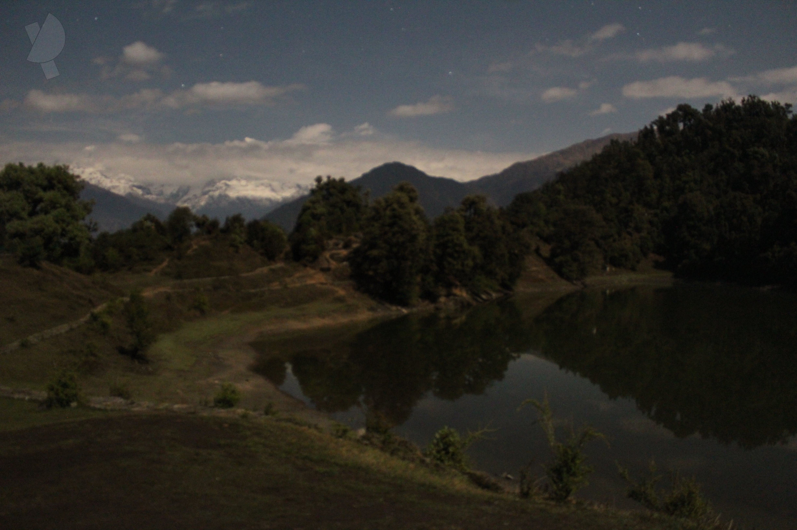
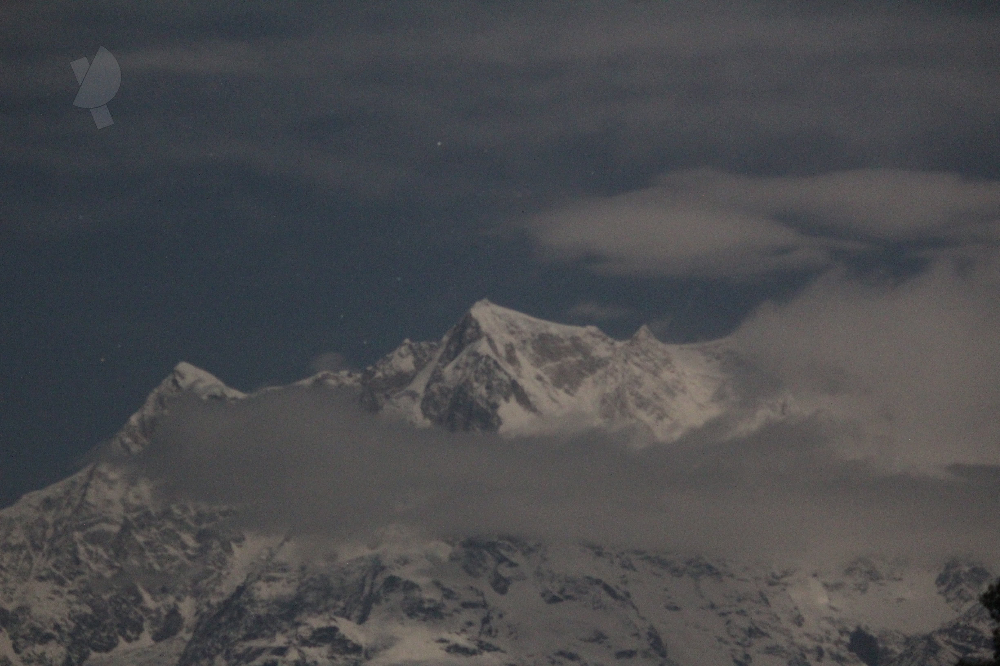
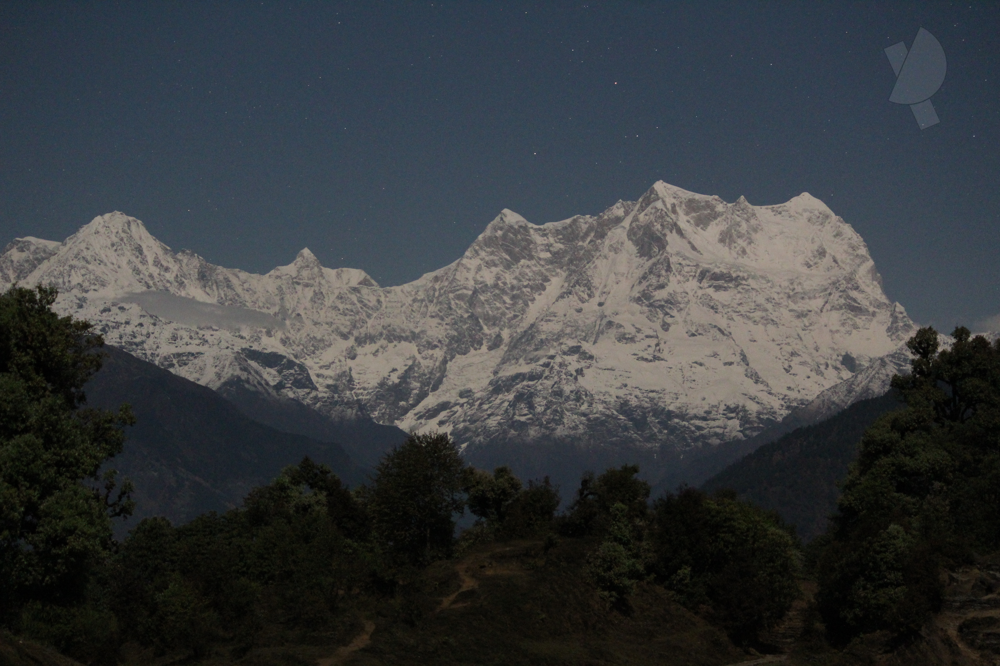
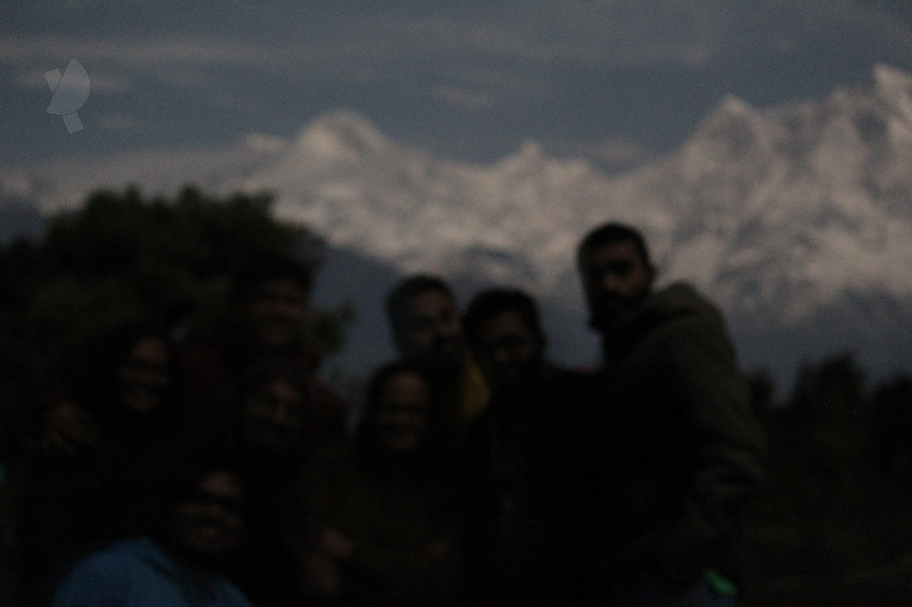

It was late night and we had climbed all the way to the top making our way through narrow paths lit up by the torch-light of our phones. For a few of us the vision would blur at regular intervals, which indicated it was time to stop and clean up our glass lenses from the raindrops and perspiration. So anyway, we got to the top, and then to reach Deoria Tal, we started going down a slope.
The thick forest suddenly ended on our right and we saw a huge meadow illuminated by the moonlight. There were a few tents and at one end there was the Taal which we were so eager to reach. From our height, the Taal did not seem all that awe-inspiring. (We realized later that we were deceived about its scale. In the mountains, you are never sure what the actual size of things is, until you get very close.)

After surveying the meadow and the Taal for a while, we moved our eyes to the sky and I became spellbound, but gradually. It seemed that a humongous cloud was lying over the horizon, which made sense since it had been raining a few moments earlier. However, there was something about those clouds I couldn't quite put my finger on. Wind blew, and some part of the cloud moved away and only then did I realize that the huge cloud we had been staring at was not after all a cumulonimbus, but it was the mighty Chaukhambha.

We knew we would get to see it once we reached the top, but we never expected it to be this gigantic. I had seen photos before and you would be seeing them too in my post, but these photos fail miserably to convey the size of these mountains. You have to be here to feel like an insignificant being while in their surroundings.
The gibbous moon, although bright, wasn't enough for our human eyes to admire the massif in front of us in complete detail. I had got my camera along with the tripod and I had hoped to attempt night-time landscape photography for the first time. I hadn't known much about DSLR photography even though I owned one. (It was one of those things you buy while in an engineering college in India.) So I set up the tripod and camera, tried to manually focus on the mountains, and let the auto mode take care of the rest. The shutter remained open for about 3-4 seconds and I waited for the result.

Heavenly! How else would someone describe it? We associate the heavens with the unattainable and mystical and these were exactly the emotions that the image welled up in my mind. (I have a theory for why these mountains feel so heavenly, but that is for another post.) Somehow after clicking that picture I was able to admire the mountains even more clearly with my eyes.
There are some emotions inside of you which get activated when you are in a certain surrounding and this definitely was such a place. It's not possible to describe them using human language and I will not attempt it. But during that night I felt the closest to the heavens and I am sure all my companions did too. It's not enough to hear from someone that Uttarakhand is Devbhoomi. You've got to feel it yourself and believe me, you will!

