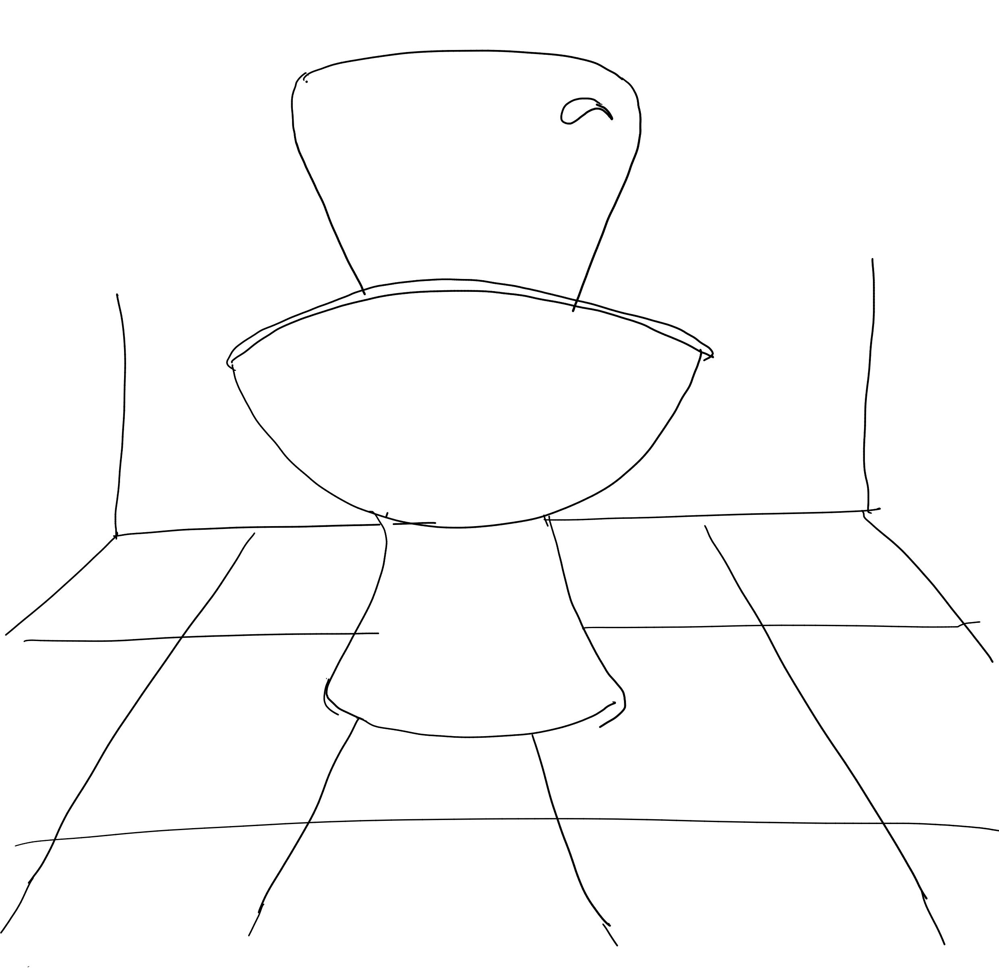
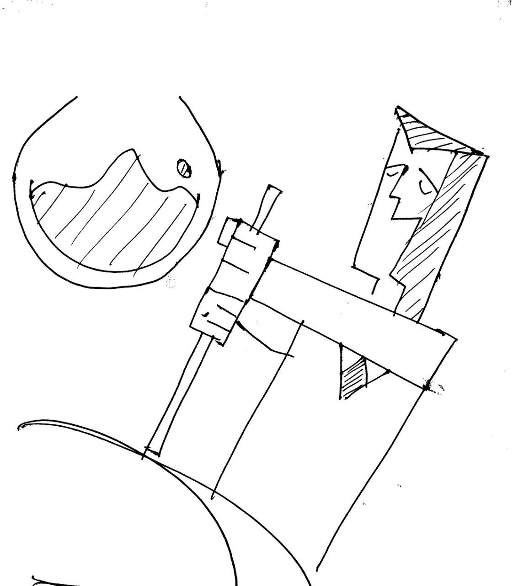
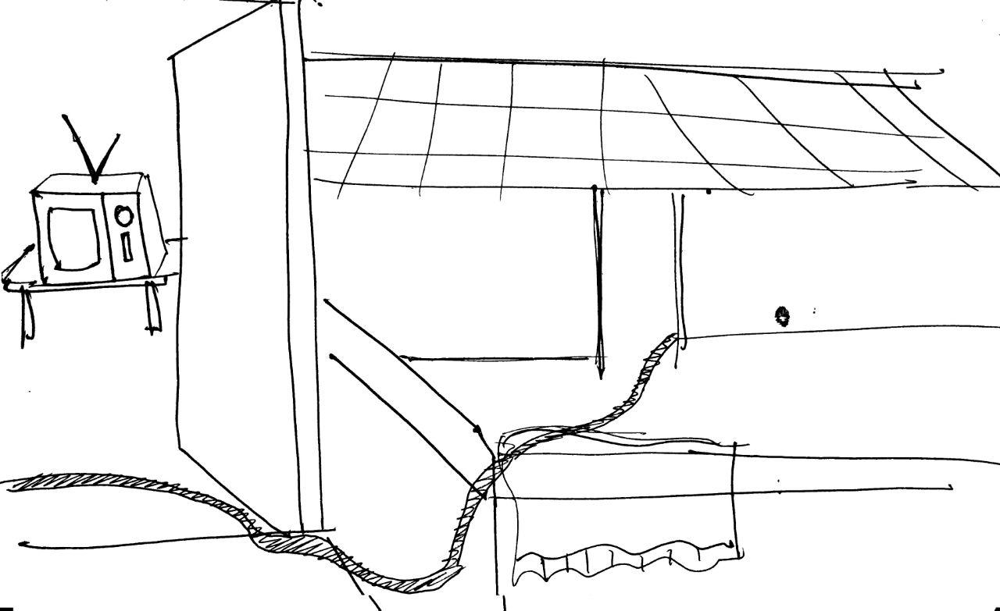
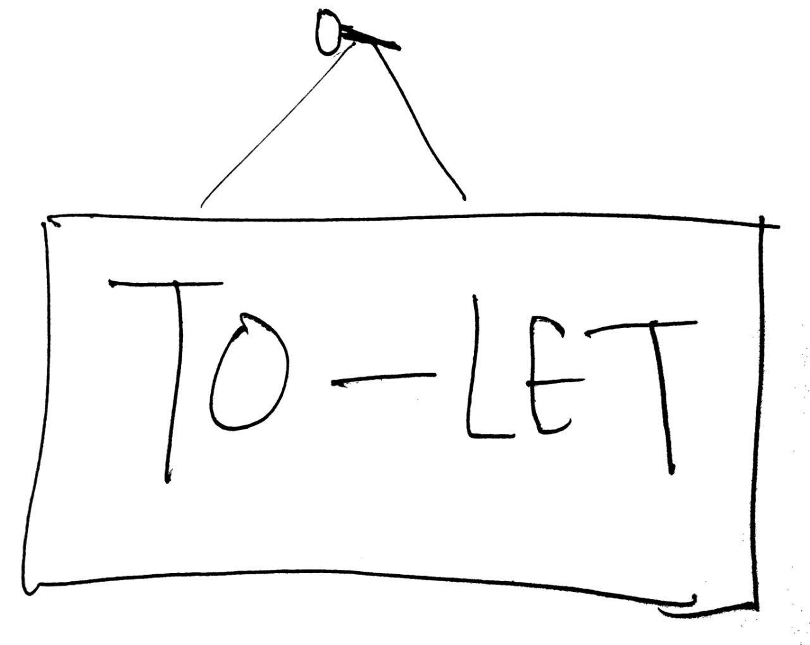
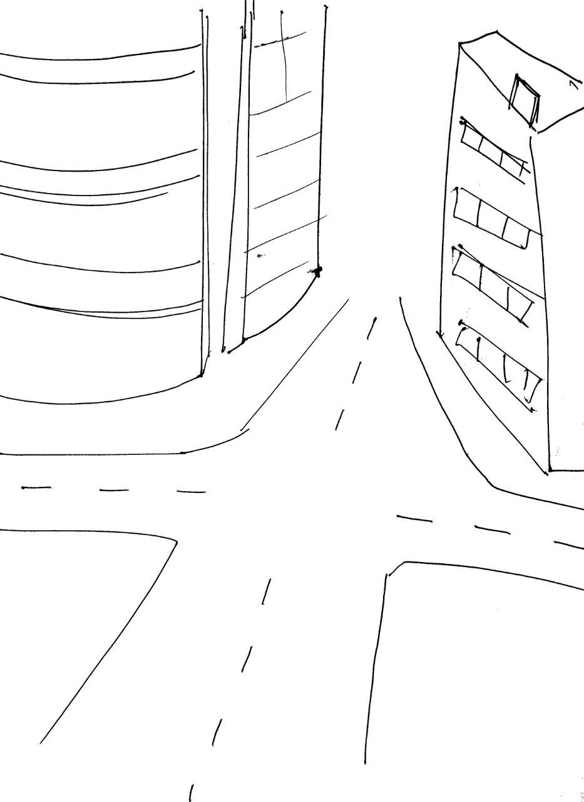
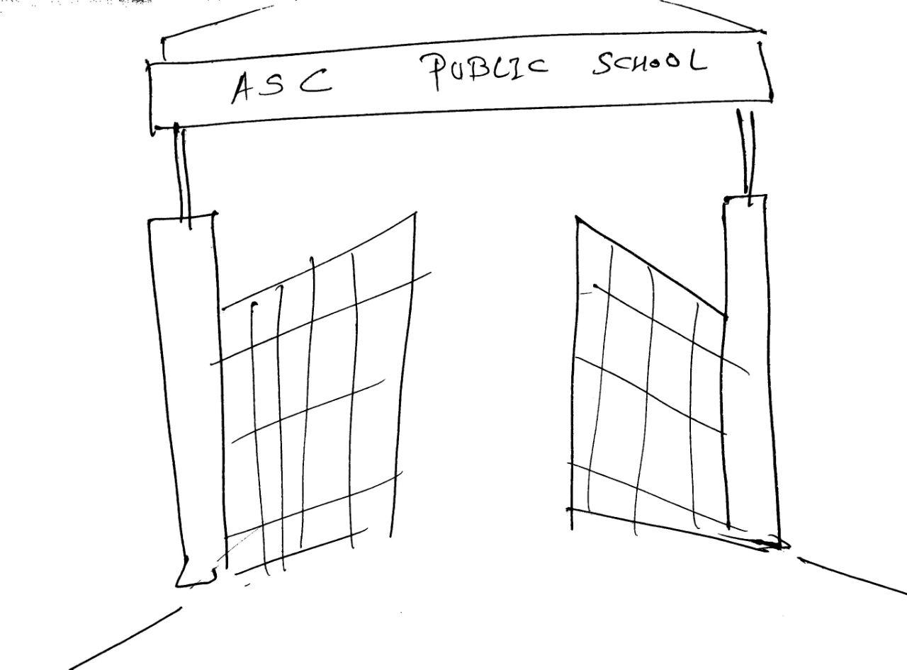
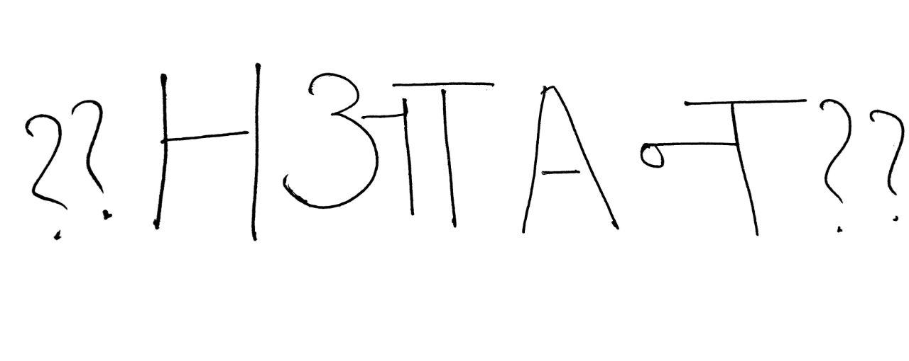

My first encounter with English and its accompanying confusions started in the toilet.   
"It's an English Toilet", my father informed me.   
I wondered what purpose it served, since I sat the same way I did in my normal toilet in Bihar. The daily ascent to the top required a lot of effort. If anything this was more discomforting. I added this to the rapidly growing list of things I would ask my local friends, the ones I was yet to make.

The problem with making friends was that they all spoke English.   
"Come da, let's play!" Raghvendra said, welcoming me in his group.  
I did understand bits and pieces. I had had an epiphany regarding "da". One of the things I was grateful for, once I moved here, was the pre-installed cable wire at our home. Our black and white TV had a dial that rotated about 12 times, and it had never been rotated before coming to Bangalore. One of those rotations was a gateway to a world of cartoons. A complete channel dedicated only to cartoons. It didn't matter if they all spoke in English. I had gotten more than I dreamed of and I didn't want to be greedy lest these be taken away. So anyway, there was this cartoon show in which there was a talking rabbit. I hardly understood any of his dialogues, but he always seemed to end his sentences with a 'da'. So perhaps that was the inspiration for these kids. Pretty impressed by myself, I congratulated myself on making this connection.   
"Ok da", I replied, mimicking the bunny.

Following along my "potential friends" for a few hours didn't seem to incite much response from them as I was unable to be part of their communication. I retired to my home and switched on the TV to meet my comprehension-less but entertaining friends on Cartoon Network. It had only been a few days since we moved here and the TV screen had started to become blurry. Perhaps it couldn't handle the overload of 12 channels. I moved my chair closer to the TV and immersed myself in a scene in which a doctor poured some chemicals into a pot and began stirring it.

"Shame! Shame!"   
I turned around and saw our neighbor in the next building calling out to me. Although I had a slight idea about the meaning (the word was similar to 'Sharm' in Hindi), the disapproving look on her face confirmed it. She then got into a conversation with my mother, probably complaining to her about my TV watching habits and eye damage in mixed Tamil and English while my mother nodded along and uttered a few words of agreement in Hindi.

I thought to myself, if someone should be ashamed then it should be her, as most mornings she smuggled water (bore water, a rare commodity in Bangalore) from our house, through a pipe hidden under laundry. However, I remembered the delicious Idly and Vada she usually gave us in exchange and thus forgave her.

My school started within a few days after shifting to Bangalore. My father decided to drop me there on my first day. The way to school was quite fascinating. There were broad roads, and even broader pathways on the sides. Perhaps that's why some motorists preferred driving on them every now and then. It seemed way more fun than riding on the road and I decided to ask my father to take that path the next time.

We passed a movie theater, named LIDO. I could see a "coming soon" poster of a movie "Spider-Man" on it. The person in the poster resembled my favorite superhero "Nagraj" but he had web coming out of his wrist instead of snake-ropes. Thus it seemed "Nagraj" too was transformed when he moved down south. Or, maybe the one in the poster was an evil twin with similar powers. Curious about finding more, I added the movie to the list of things I would nag my father for over the coming weekend.

My gaze, along with the scooter, moved to the buildings next to the theater. The buildings seemed newly constructed but I wondered why had they constructed only toilets on it. Not only that, the English-versed people of Bangalore had even got the spelling wrong. Each of the multiple boards on the building read "To--Let". Giving it more thought, I finally concluded that the letter I of the printing press may have rotated sideways by mistake and printed all these boards wrong.

We soon came to a junction of roads.  
 "It's called the Trinity Circle", my father informed me.   
Confused, I reasoned that the local geometry books must have also undergone geographical changes like the [Samosa's recipe](../../../../2020/08/30/samosas-in-bangalore/). However, my train of thought was derailed by the sight of some of the tallest buildings I had seen in my life at the "Corners" of the Trinity "Circle."

There was a building on our left which had a board of "Vijaya Bank" at the top. There were two grayish buildings in our front that resembled the ones in English TV shows I had managed to sneak a glance at while quickly changing channels. I was impressed. We took a left turn and proceeded towards my school.

Once I got off the scooter at my school, I got showered with instructions.  
"Hail an Auto-Rickshaw."  
"Tell him, 'Hanumaiah Reddy Road, Ulsoor!'"   
"Don't forget to say, 'Meter!'"  
"To any of his questions, simply reply, 'Kannada Gotilla!'"  
"Give him Rs. 7 once you reach home."  
Equipping me with the above knowledge and the moolah, my father left me at the gates of my school.

Standing at the gates, I went over the dialogues in my mind for the millionth time.   
"Hi"  
"How are you?"  
I decided I may throw in a "Dude" or "Man" here and there (Fresh knowledge from the cartoons.)   
I entered the class and rushed to the empty seat at the back. I didn't want to sit at the front being exposed to the teacher's questions in English. There were two other students sitting next to my seat and they both turned towards me at once. I gulped and quickly revised the greetings and questions in my head. My struggle with English for the past few days had made me very nervous. Almost trembling, I changed my script at the last second and instead asked them hesitatingly.  
"You know Hindi?"  
"Haan", they replied.

"Haan?" What does that mean?? I hadn't come across this word in English yet. I tried to recall all the words which I had recently heard but couldn't find a match. Was it the accent which deluded me or were they mocking me? Before I could reply with my ready-made dialogues, it dawned on me that it was Hindi that they were speaking.

I gave a sigh of relief and forgot all about my prepared lines. I improvised in Hindi and greeted them all and inquired about their well-beings. Finally having found friends I could talk to, I joyfully looked forward to my first day at school in Bangalore.
