With my mind wandering every night to the Uttarakhand mountains, staying away was unbearable. It had been one whole year since our transfer to Jorhat, Assam but we were still engulfed in the charm of the Himalays. We finally decided on a trek/pilgrimage to Rudranath, climbing which was as difficult as defeating the Germans. ( I am not making this up! The title of the post is a popular saying among the residents of the villages nearby Rudranath). We made the plan as perfect as we could. This was one of the rare trips where everything fell into place (almost), and we could do things as we planned.

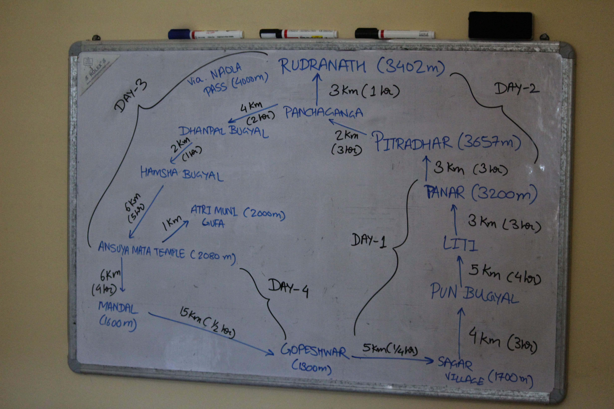

The plan was for a 3-day trek starting from Sagar Village. We planned to return using a different route than the one used for ascending. However, that depended on whether we could find a few more trekkers on the way who would be descending down the same path. The reason was that the path was through a dense forest.

We arrived at Haridwar station and got on the bus to Gopeshwar. Just after passing Rishikesh, my memories and the images from my dreams in the previous year started materializing on our bus windows.

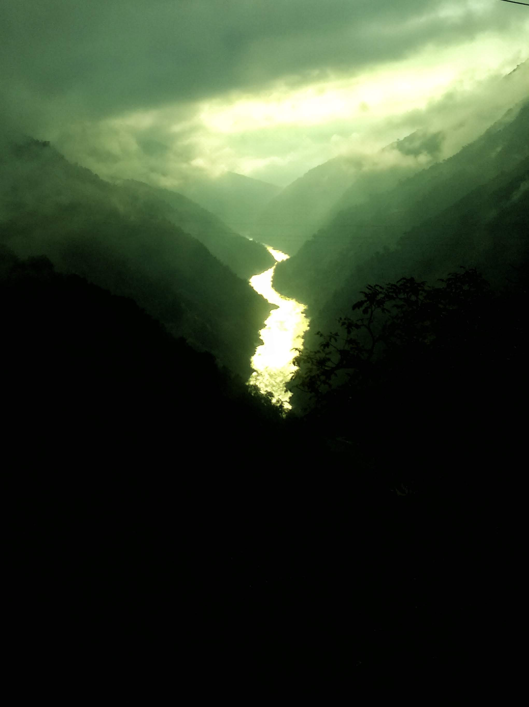

On my right, the river Ganga had taken on a golden hue. The morning sun filtering through the clouds in the valley made the whole scene surreal. I felt myself descend into tranquility as once again I journeyed into the land of the gods, Devbhoomi Uttarakhand. Passing the famous prayags (confluence) of the river Alaknanda one by one we reached Gopeshwar by evening. Our hosts were our house owners. We were so grateful to them for inviting us to stay in the same place where we had accrued so many memories.

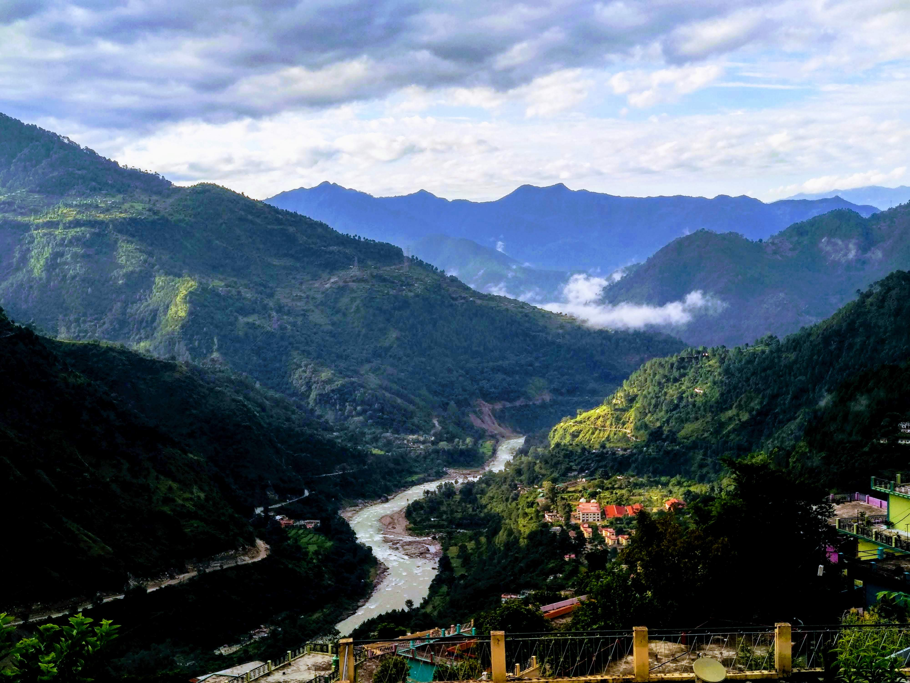

Waking up, the first thing I did was to run upto the terrace and look for the scene I had missed all year long. The river Alaknanda flowing through the valley, passing next to the college where we taught for almost a year. The sun illuminated the college building, intensifying the nostalgia. This view is forever imprinted into my brain.

We got up early. Our trekking partners, Lijo and Lijin too had reached Gopeshwar the previous day from Pantnagar. They were supposed to meet us on the road. Our hosts were generous enough to get up even before us and prepare our lunch for the trek. All of them came up to road to bid us goodbye. They wished us luck, although some doubted our capabilities. The Sumo soon came to meet us with our friends inside. We got on and started towards Sagar village, on the route we drew and erased so many times on our whiteboard in Assam.

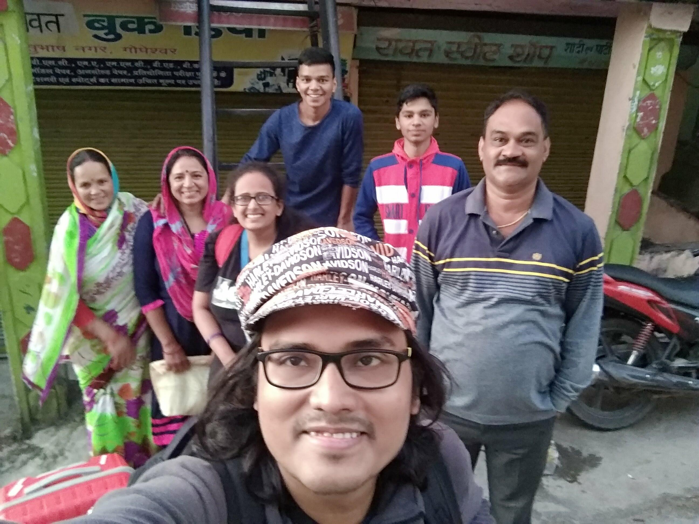

We left some of our extra luggage on a hotel in Sagar. We had planned to stay at that hotel when we returned. Our driver suggested that we carry walking sticks with us. The hotel people were generous enough to give us a stick each with the promise that we return them on our way back. After a selfie on the entrance to trek we started on a journey to collect memories.

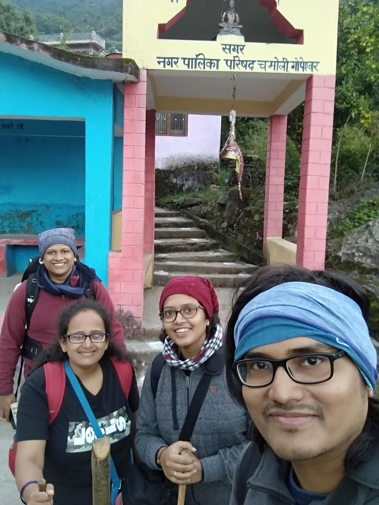

Although the sun had come up, a mountain separated us from its greetings. It was probably good as we could cover more ground when the sun wasn't directly shining upon us. We quickly made our way through the village. We needed to ask a few locals about which of the many paths to take that would lead us to the foot of the mountain towering ahead, which we needed to scale. The temple was on the other side of the mountain further along the ridge.

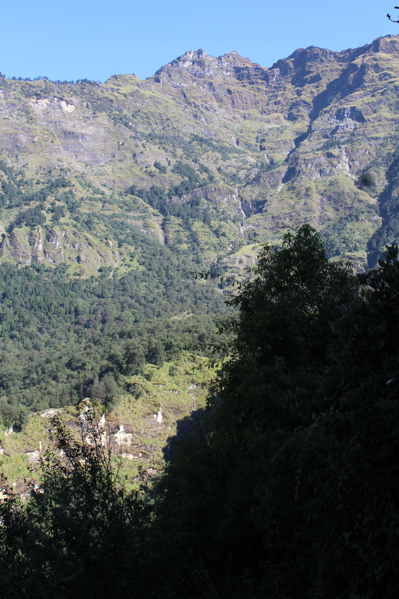

We found our first stop just after about 10-15 minutes of walking. This was the place where two paths leading to the main trek met. It was marked by a pratikshalaya (A waiting place). We rested there for some time and drank a glass of refreshing Buransh juice. There were a few others too, who were headed our way. Soon after finishing our drinks we filled our bottles from a stream nearby and started on the path ahead.

We soon reached our first pit stop, Pung bugyal. There we met a group of students from the college we used to teach at. They were from civil engineering and recognized Abhigna. They were all 'Pahadi' and were very quick on their feet. They greeted us and handed us candies which they were eating and sped up ahead. We decided to lay down, take rest and have our breakfast. We looked for a dry place to sit down. We found a stream nearby and filled our bottles. Finally settled we sat together in a circle and relished our breakfast. Our food from now on-wards depended on the lodging facilities at each of the three upcoming bugyals. They mostly had food, but the availability depended on the number of pilgrims visiting them on any given day. They had limited ration and even limited resources to carry ration up the mountain.

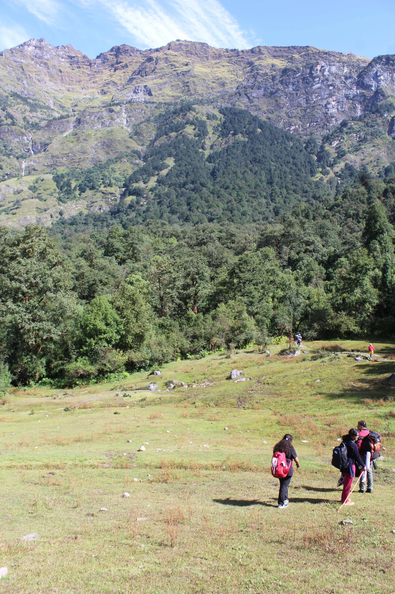

We were soon done with our breakfast and were quite content with the progress we had made thus far. We were packing our stuff, when we noticed a middle aged man walking returning from the trek up ahead. We asked him how much more distance was left to cover. He replied that you haven't even started. The climb up ahead was nothing compared to what we had done till now. The real climb started just beyond the bridge up ahead. That is when we actually set foot on the mountain to be climbed. We didn't waste much time after this and soon walked full speed ahead to the mountain up ahead.

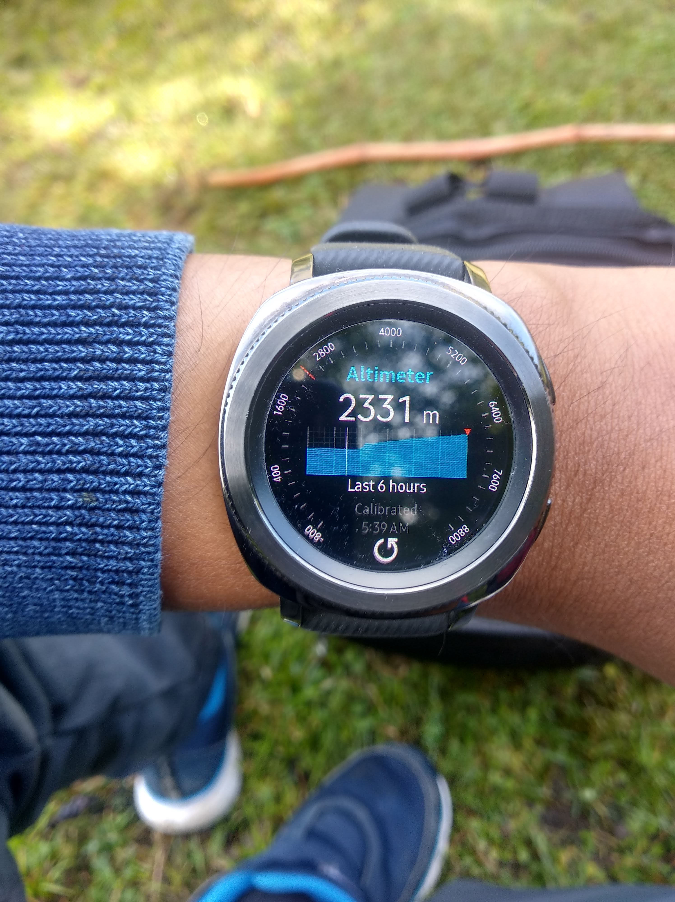

We soon came across the bridge. The climb was indeed steep on the other side. The path was like this till Panar bugyal after which the way was comparatively easier. We had planned to spend our first night at Panar bugyal and thus had to reach there before sunset. Me and Abhigna had been preparing for this moment since the past 4-5 months. Hoping that our squats and lunges would pay off, we started excitedly on the strenuous part of our journey.

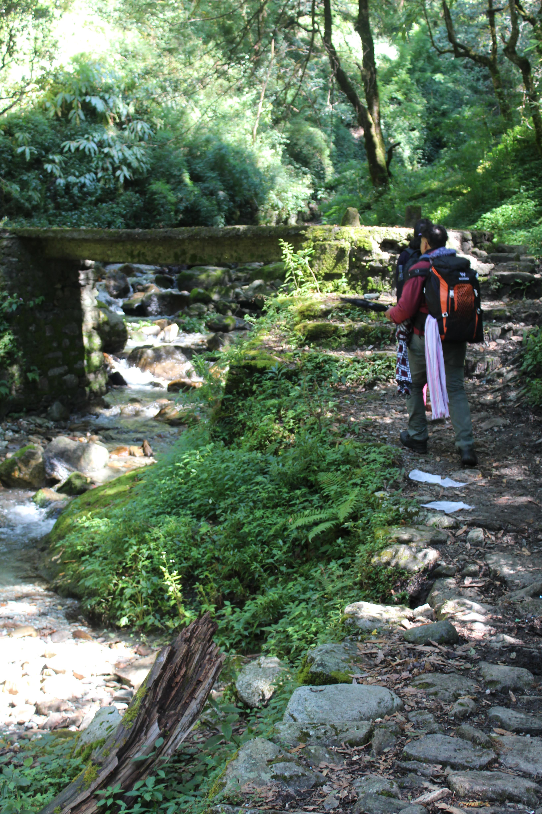

We walked continuously through the thick tree cover. On the way, we met some men with ponies who carried people up for a fee. They warned us that drinking water wouldn't be available till the next stop, Mauli Kharak. Thus, we were advised to fill our bottles with water from a stream just ahead. The water seemed to originate from under the roots of a tree and through some boulders. We quenched our thirst, replenished our bottles, and continued on our journey.

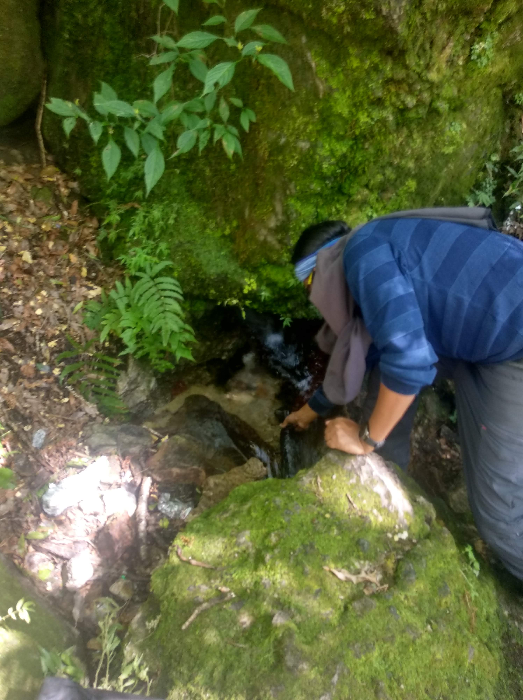

It was only after about a couple of hours that the shade of canopy ended and we were provided views of the path we had taken since morning. Looking closely, we were excited to identify a bald patch in the the forest as Pung bugyal. We were proud of ourselves for having covered so much distance. We took a break there for a few minutes.

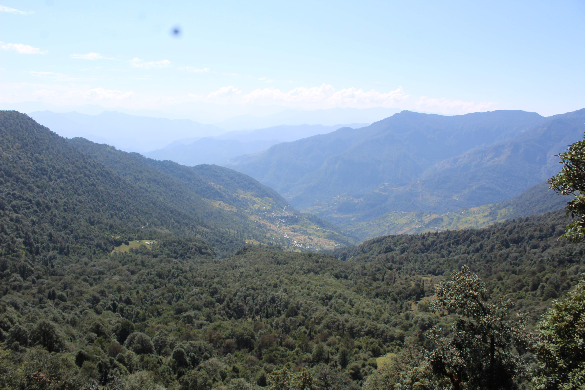

We had used up almost all our water and the next stop, Mauli Kharak was still quite some time away. Thankfully we met a few people who were coming down and they happily offered us some water to drink. We inquired about the route ahead. They doubted that we would be able to reach Panar bugyal before sunset. The view at Panar is famously exquisite and we wanted that to be our reward for all the hard work we had done today. We headed quickly for Mauli kharak to gain some lost time.

The last bit of distance to Mauli Kharak was covered with a lot of complaints about hunger, thirst, tiredness, etc. We had been walking non-stop and desperately needed some rest. Thankfully, there was some food available at that place. we sat down on a few boulders, filled up our bottles from a nearby stream and relaxed. I took out my camera and hoped to capture some exotic birds, but a black crow sitting on a branch next to me held my gaze in a stare-down battle and eventually I had to capture him in my camera. On our way, there was a place called Pitradhar, where according to legends our ancestors visit in the form of crows. Remembering this bit of information, I respectfully removed my gaze and got back on track.

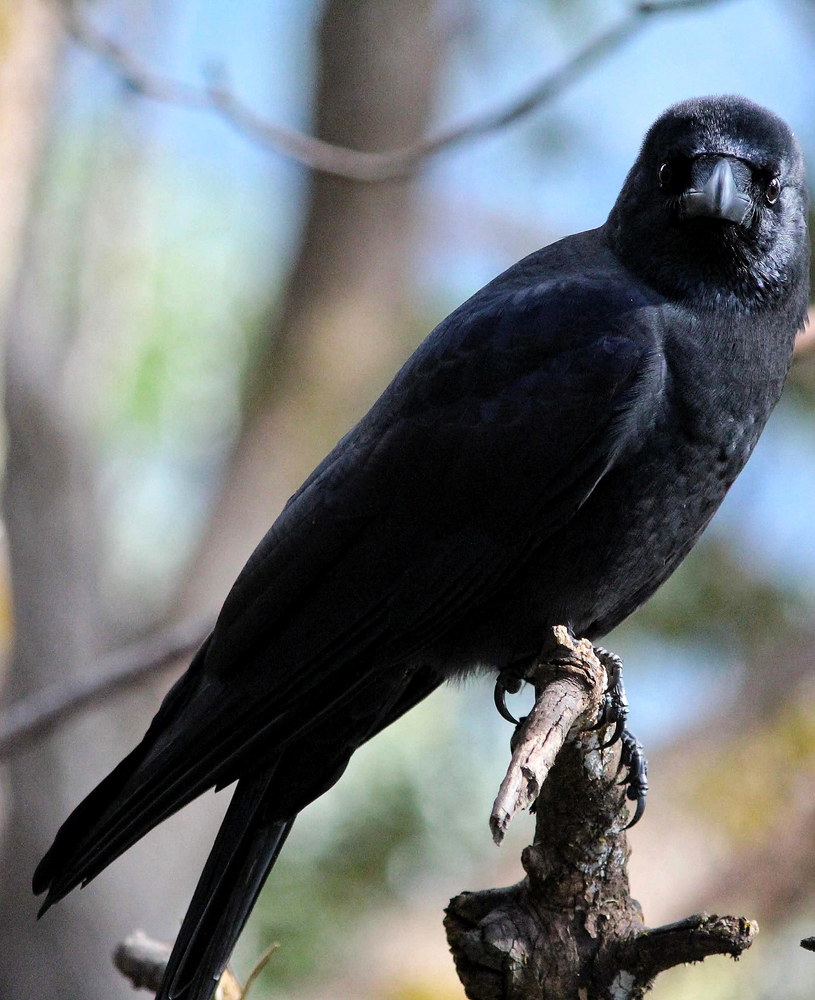

As dusk approached, our plan on reaching Panar before sunset started to seem impossible as all of us were extremely tired. Climbing for about an hour, we could see a grassland approaching. It was Luiti Bugyal.

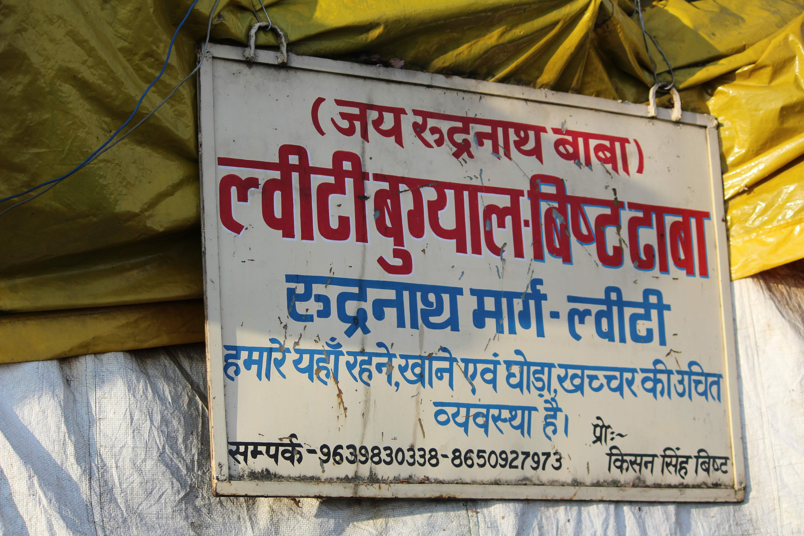

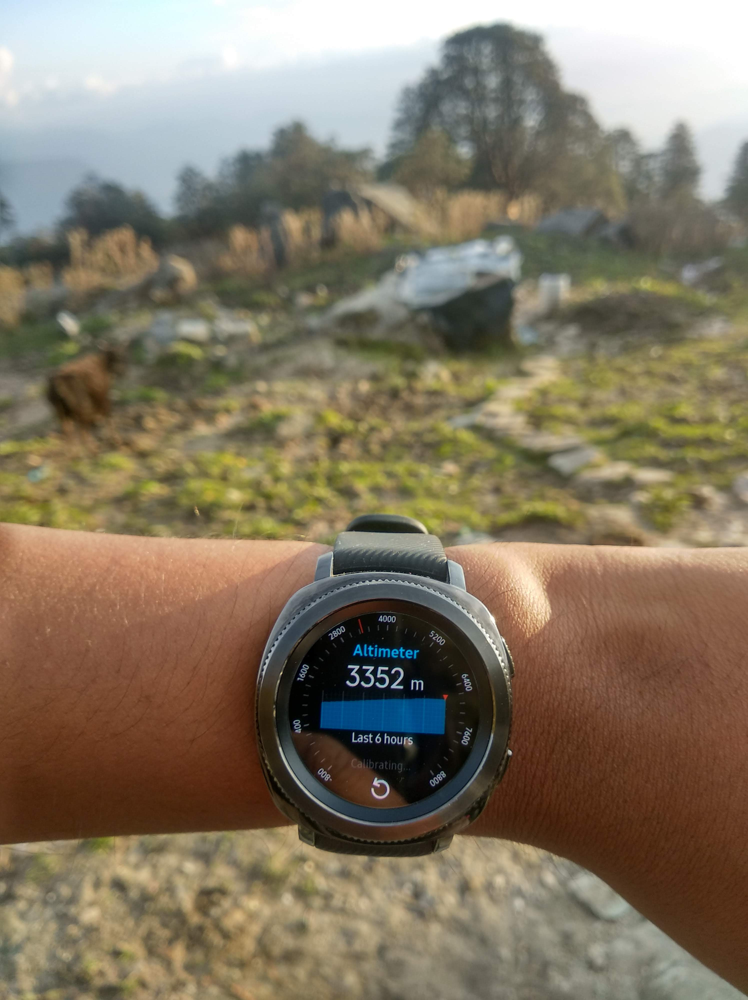

We collapsed on the plastic chairs kept outside the stone hut and mutually agreed that it wouldn't be possible to cover any more distance today. The caretaker who was a friend of our house owner, welcomed us and offered us tea. And thus once again we relished the coveted pleasure of sipping tea in cold mountain weather while chatting with friends.

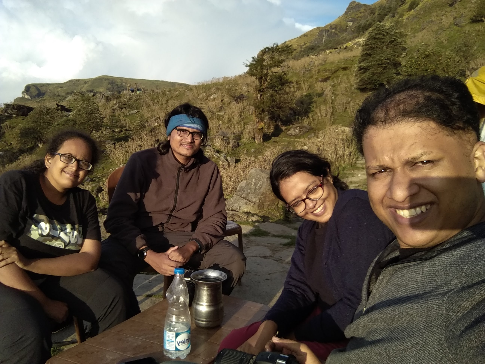

We took some photos of the wildlife. One of the most beautiful and elegant cows I have seen.

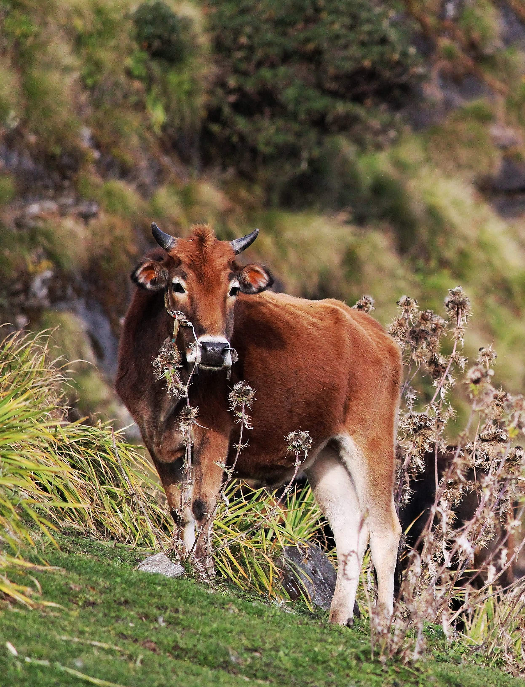

There was still some time for the sun to go down. Energized with tea and biscuits, me and Lijo decided to explore around and gather images with our cameras. Nearby we saw a bunch of cattle grazing, a dog, and his pup keeping guard. The puppy who was playing along with fawns had started to behave like one. It was one of the fluffiest puppies I had come across. I was a bit taken aback to see a thick metal collar with spikes around the guard dog, which seemed quite uncomfortable. I was informed that dogs need to be protected from Guldars(Mountain wild cats) as they attack the neck first. Taking a lot of pics and playing around with the puppy and fawns we headed back to the our hut as the sun neared the horizon.

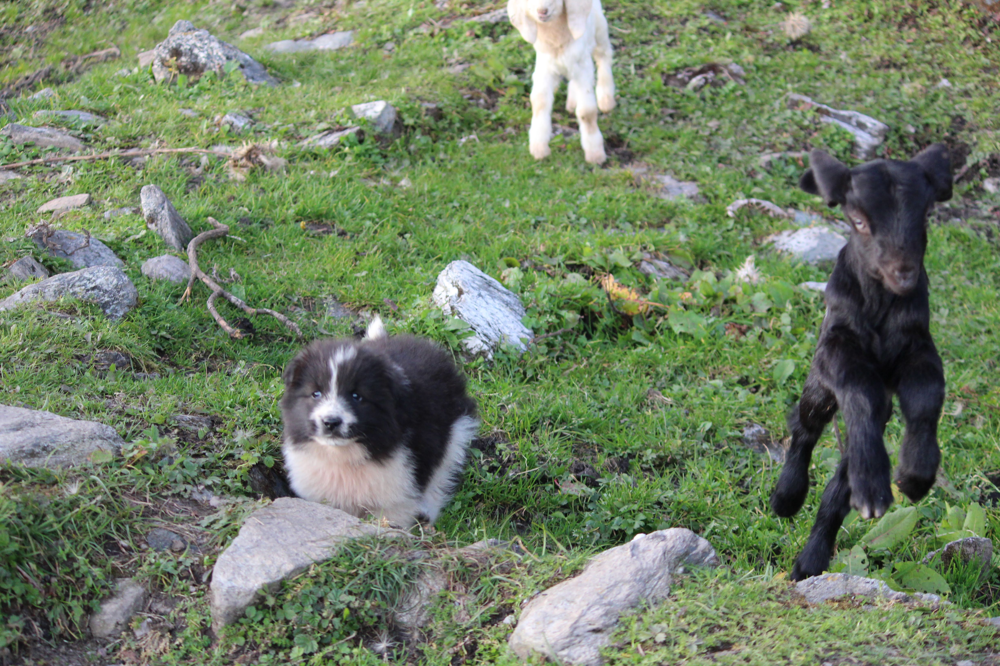

The hut was split into two parts, with the kitchen in the middle. There were many beds laid on the floor for pilgrims. The floor itself was insulated from the cold ground by Styrofoam sheets. Overall, the place looked very cozy and comfortable to us tired souls.

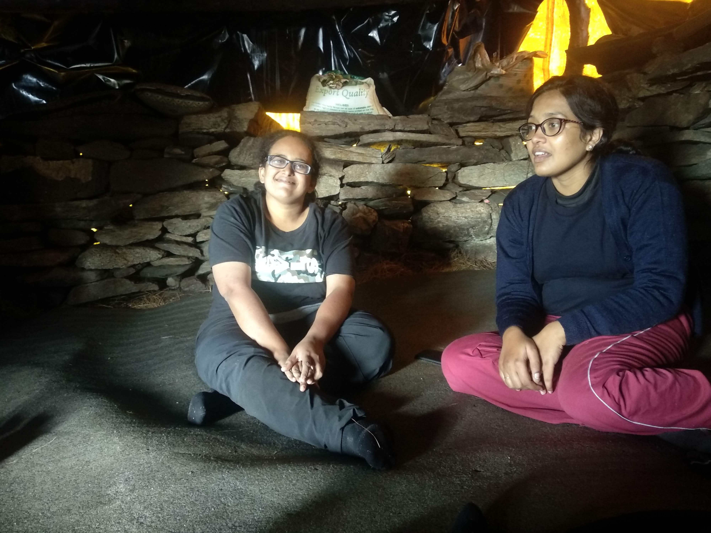

We were hoping that apart from the four of us, it would be great if no one else came to our side of the hut. This wish was fulfilled as night approached, and no one else entered our home for the night. The caretaker got busy cooking dinner for us, and soon, on our plates, served some delicious food for the night. With the taste of heavenly hot food in cold mountain weather we were completely satiated.

The night was spent comfortably under the cozy blankets of which there was no shortage. We got up early the next morning as we had more than half the distance to cover. Also, we were eager to reach Panar, which was only about an hour's trek away. We took off soon after freshening up, gulping down the morning tea, and making the due payments.

The weather was cloudy on our way to the top. During our trek on this side of the mountain, we didn't see any snow-clad mountain peaks. They were all hidden behind the mountain we were climbing. As we started nearing the top, a glimpse of mighty Trishul excited us and energized our tired bodies. We wasted no time in completing the rest of the way to Panar.

I was walking ahead, and Abhigna was lagging behind. Unable to contain my excitement, I covered the last stretch quite quickly and came back to Abhigna even quicker to describe the amazing scenes I had witnessed.

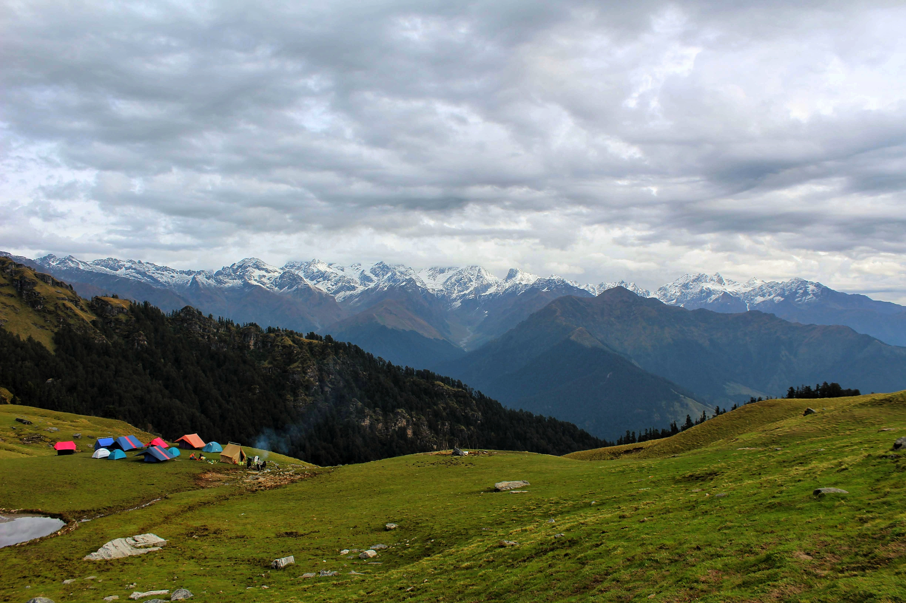

We lay down on the lush green meadows, locally called bugyals. There were a few cows getting their breakfast fresh from the fields. A few tents were pitched down the hill. We were tempted to approach them for our morning tea, but we had to first take in all the scenes around us until we were satisfied.

Up until Panar, the path is quite steep. Locals call it 'khadi chadhai', literally meaning a vertical climb. The way ahead wasn't as strenuous. We prayed at the temple dedicated to forest gods and continued ahead. The mountain ranges visible from this side of the mountain had so much detail in them which lay obscured behind the ever shifting veil of clouds. Every few minutes we would turn and raise our heads in their direction and be surprised by the something previously unseen. A river flowing from the very top, through a deep valley was presented to us. It was one of the most memorable scenes.

We walked for about a couple of hours on the ridge of the mountain, meeting people on their way back and always asking the same question. "Aur kitni door?" Clouds accompanied us on this part of the trek and offered us mesmerizing views each time they cleared, much like a magician revealing whats behind his veil.

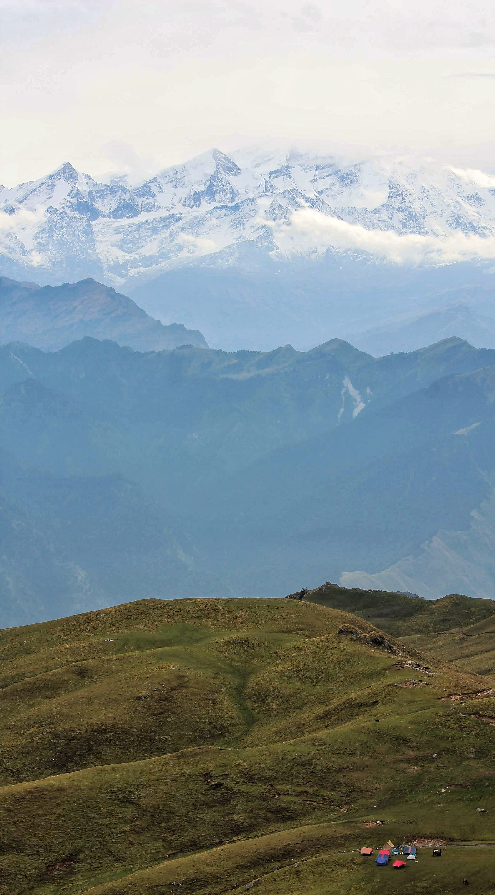

The next stop on our map was Pitradhar. Here we had to cross the ridge from one side of the mountain to the other. There was sort of a gateway constructed on this pass and the view on the other side was again spectacular. However this time we focused more on our growling stomachs and quickly ordered some food. But we were late, and the food had almost runout, there were only two aloo parathas left along with some rice and local daal. We took what we could get. The steaming hot dal and chawal was as delicious as one could hope for at this high altitude place at almost 4000m above sea level.

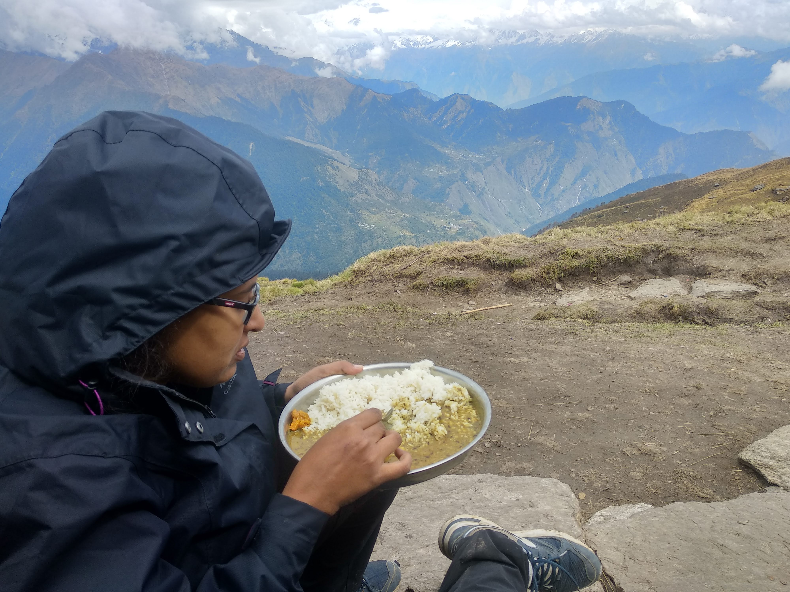

This was the highest point in our journey. For the next few hours we had to walk down a gentle slope towards another pit stop, panch ganga. Five individual streams flowed there, that's why the name. Tiredness was setting in and we hoped to reached our next resting spot soon.

We didn't take long to reach panchganga. There are lodging facilities there for travelers. We sat down for a few minutes but we had to get back on track soon as evening was approaching quickly and we had to reach Rudranath soon to secure our bed at the final camp. The path meandered behind a mountain ahead and no matter how much we walked, the path always seemed to turn around the corner.

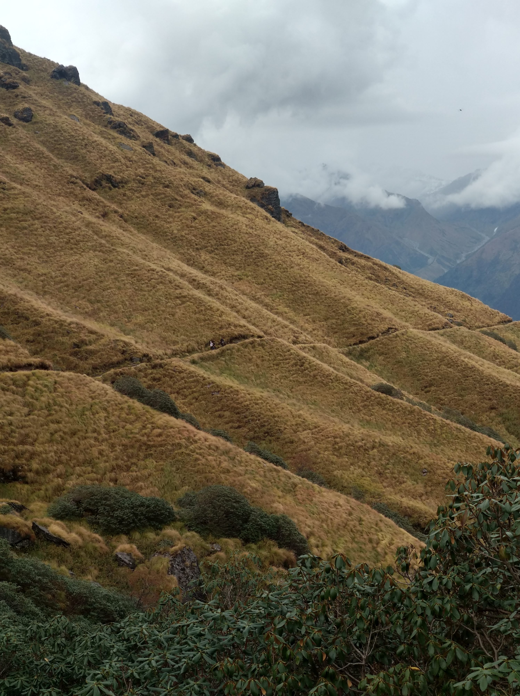

The last bit was quite difficult. However as we turned a corner, we came at "Dev Darshini". It's the first point from where the temple is visible. You ring the bell and let the Shivji know that you're on your way.

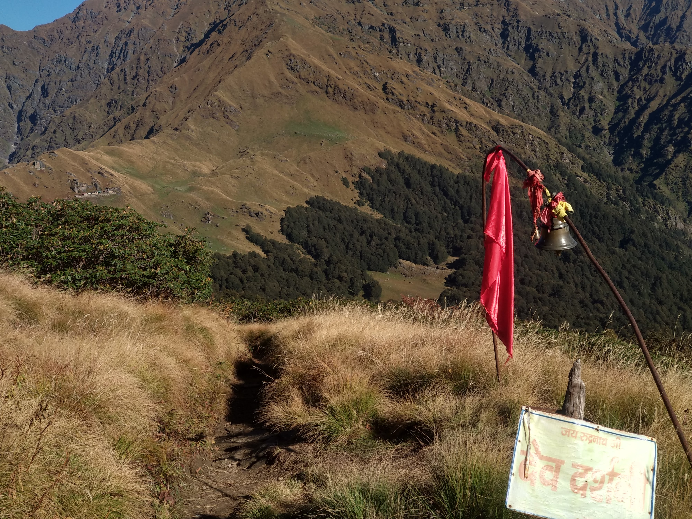

The sun had started to set and we went down the slope towards the last part of out journey. We reached our final stay at about 6:30 PM. We quickly enquired for a room for four. We were shown to a room filled with blankets. Content with it we soon refreshed ourselves a bit and headed towrads the Lord's abode.

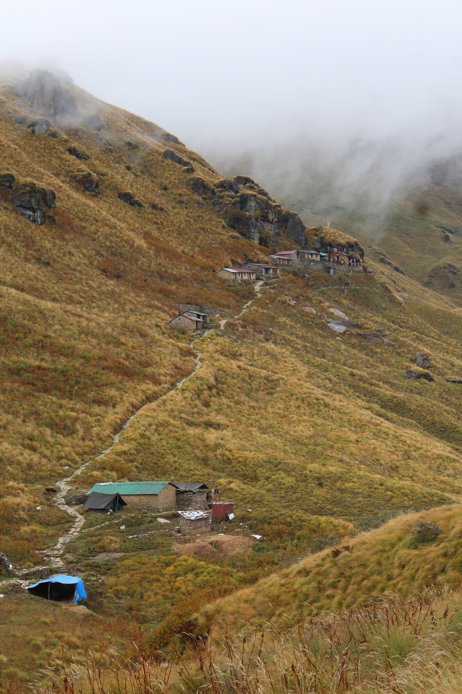

We wanted to be a part of the evening aarti, thus we quickly climbed up the steps to the temple. It started raining a bit, and we took shelter under a shed until the head priest came. We followed him inside the temple and he started with preparations for the aarti. There were about 10-15 people in total. All of us prayed and thanked lord Rudranath for letting us visit his pristine and serene abode.

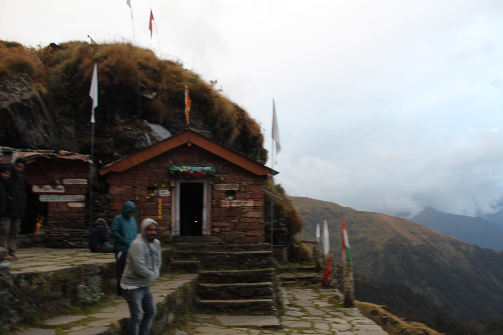

We got back to our stay and had a sumptous, hot and steaming dinner. The chapati and vegetables put in our plates directly from the oven. Soon after finishing my dinner. I took out my tripod and setup my camera to take some night shots of the mountains surrounding Rudranath.

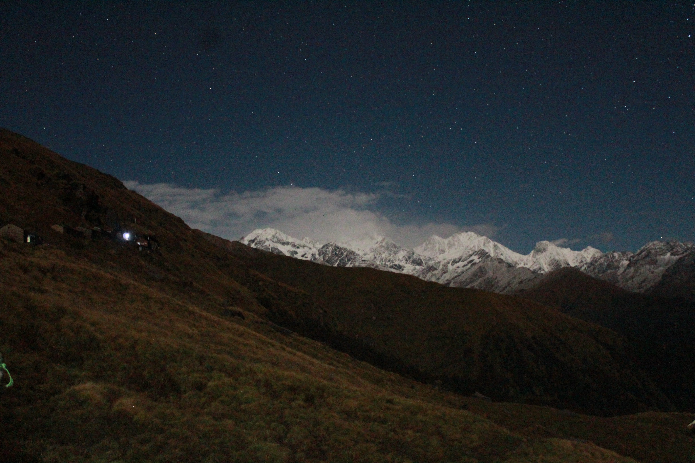

Having finally caught some sleep after shivering from the bone chilling cold most of the night, I started dreaming of the incredible vistas I had seen during the day. In dreams, one’s subconscious usually comes up with images which are fantasy but obviously my brain had difficulty conjuring up images any better than the one it had already seen the previous day. Thus all I could see in my dreams were the beautiful pathways I had trodden all day. These images seemed as unbelievable as they did during the day as they did in my sleep.

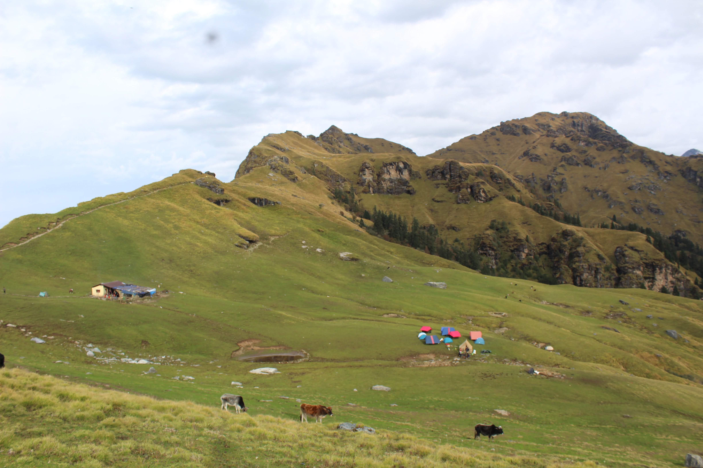

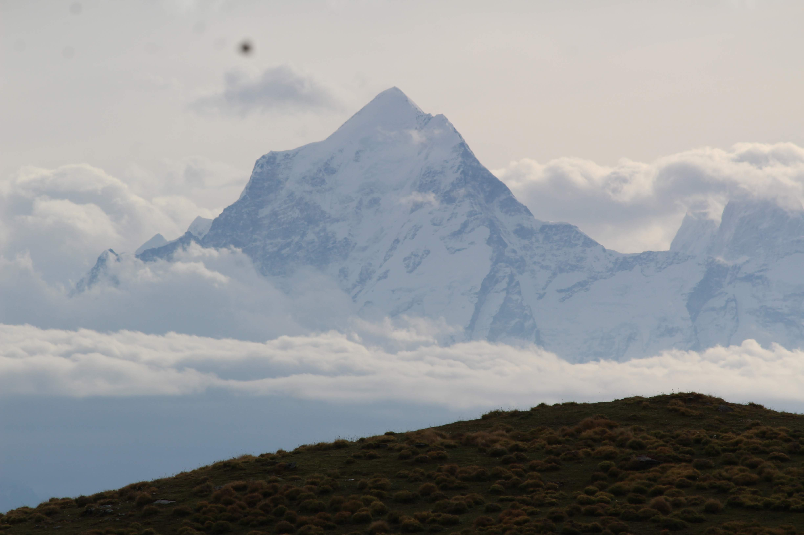

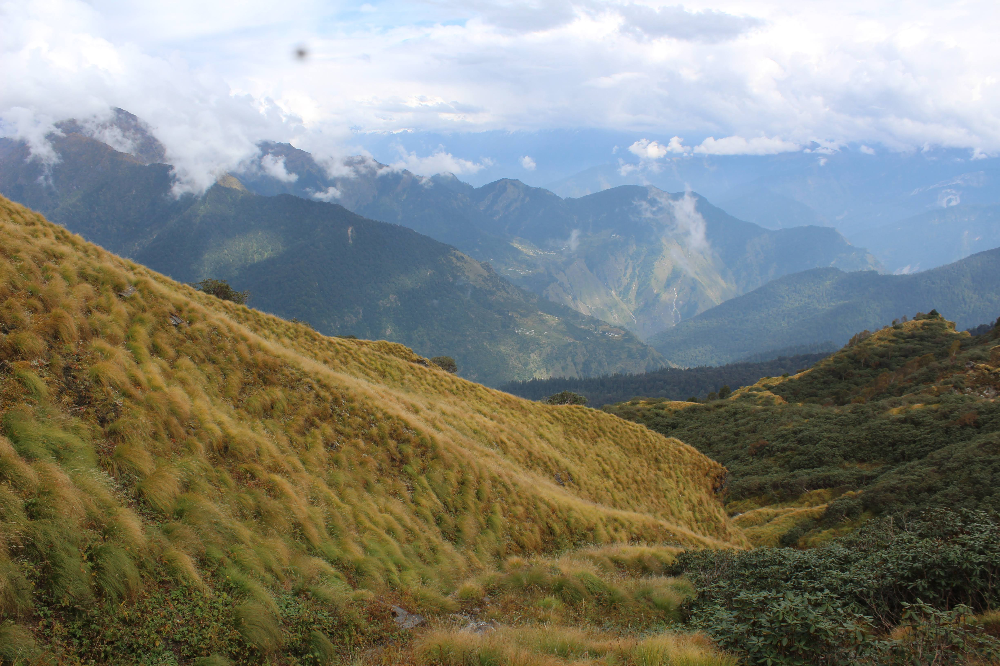

The dream ended and I woke up happily, completely aware of the fact that apart from my eyes being open now, nothing else has changed. I got out of the layers of (Heavy) blankets and opened the door of our stone house which had kept the insides relatively warm. Stepping outside in the cold morning, the sight in front of me stirred a primal fear within. The sight of sharp and tall, humongous mountains forming an inescapable wall on the horizon intimidated me. Being afraid was the last feeling I had expected to encounter in such a divine place. I felt imprisoned.

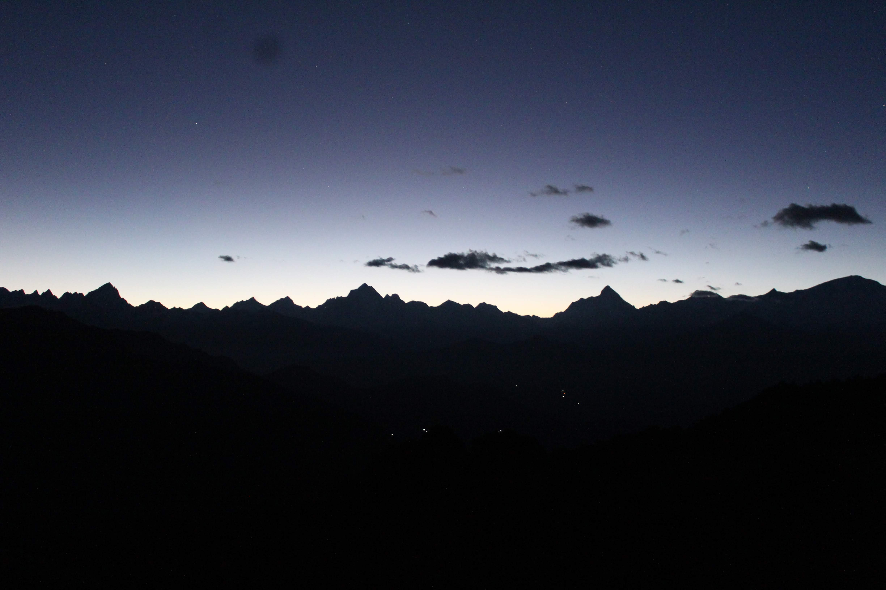

However fear turned into astonishment as my brain started processing the shapes of each of these peaks. I realized that I was being offered views of all the mountain peaks which had eluded me the earlier day. There it was the mighty Nanda Devi, the second tallest peak in India and then Brahmkamal and also Dronagiri and wait there was Trishul too! All presenting their silhouettes with the sun rising behind them. I had been in Uttarakhand for almost a year (and been to Auli thrice!) but hadn’t been deemed worthy of a glimpse of Nanda Devi peak. However climbing all the way to Rudranath must have convinced the weather gods to bestow upon me this wonderful view!

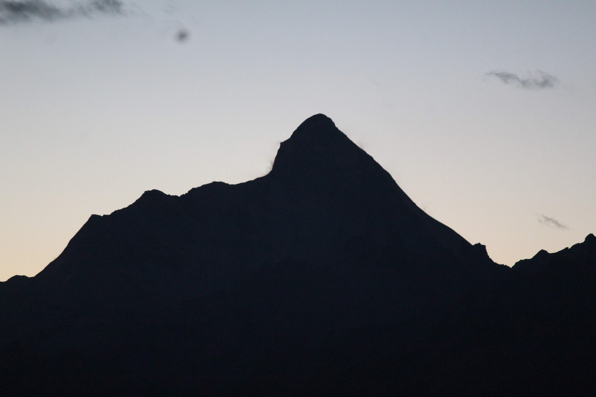

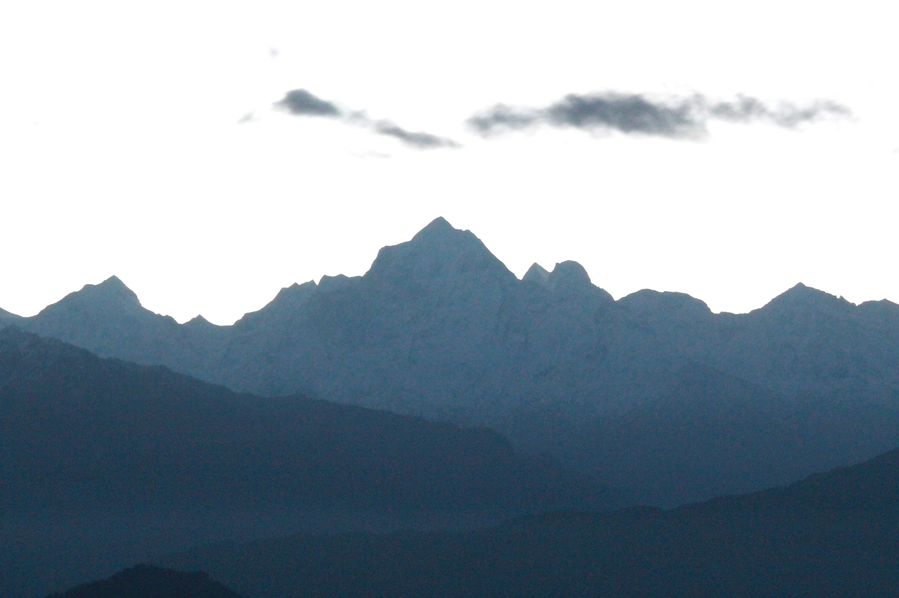

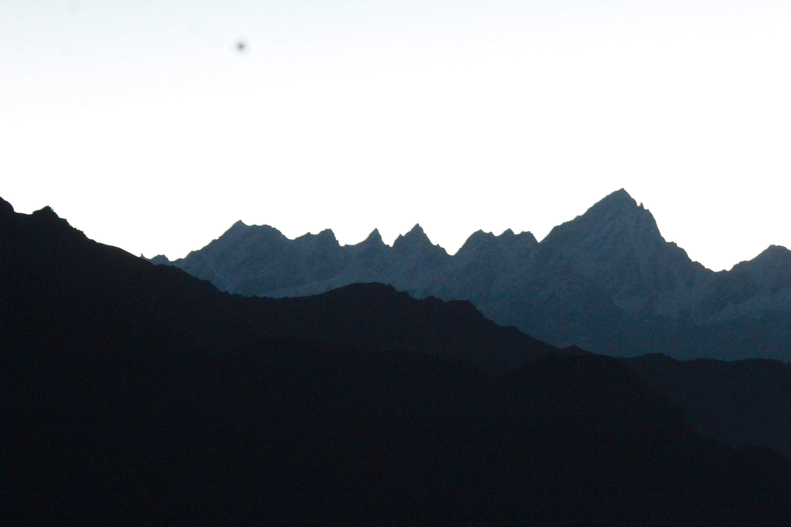

We climbed the steps again to the temple to seek blessings for our return journey. The early morning was almost as cold as night.

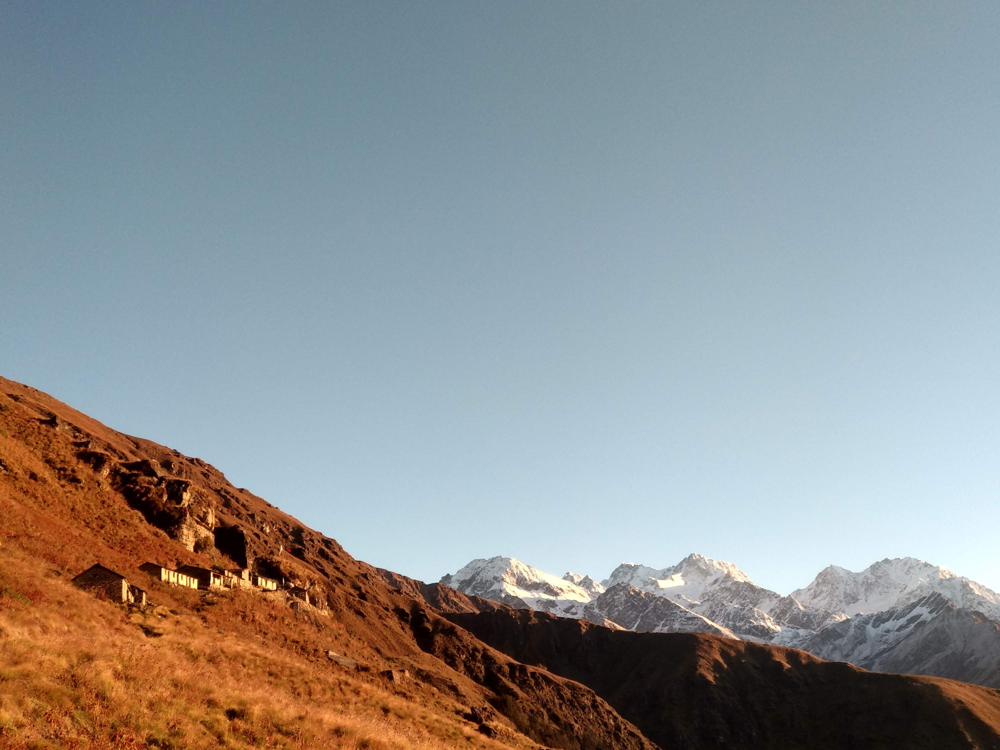

According to our plan on the whiteboard, we wanted to take the route to Ansuya Mata Temple and climb down the other side of the mountain. However we couldn't find any companions on the way. Our friends too had to take mules back to sagar as they had developed sores in their legs. The planned route was through a forest area and thus it would have been dangerous for just the two of us. Eventually we decided that we would retrace our path to sagar.

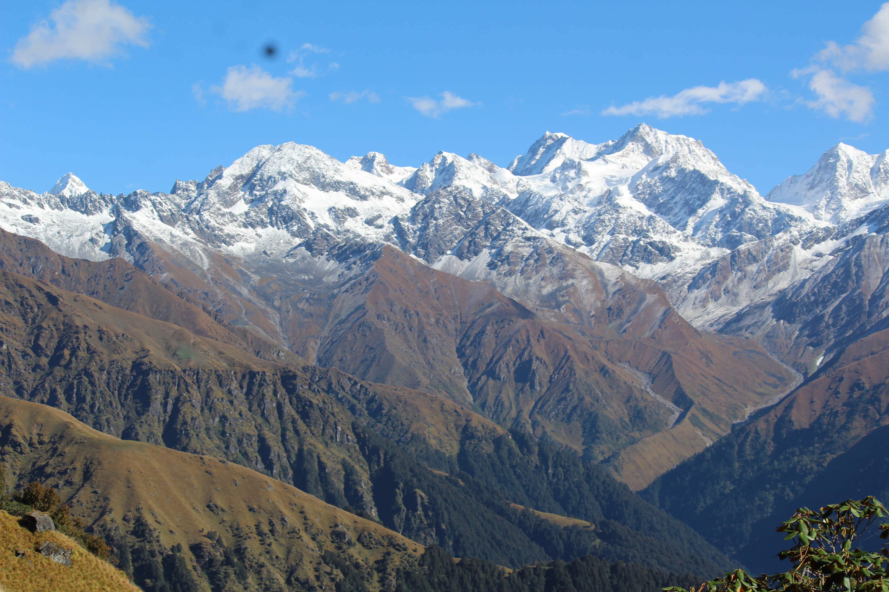

We had planned to reach sagar on the same day, but our legs couldn't keep with our mind's resolve and thus when we relaxed at Panar, we decided that the furthest we would hike today would be till Mauli Kharak. After Panar, we started climbing down the face of the mountain and reached Luiti Bugyal in about an hour. There we were informed that a large group had recently left for Mauli Kharatk and thus chances of finding a stay there were slim. Therefore, we decided to end our journey for the day at the stone hut of Luiti. However, the same night we found out that the stone hut wasn't so solid after all.

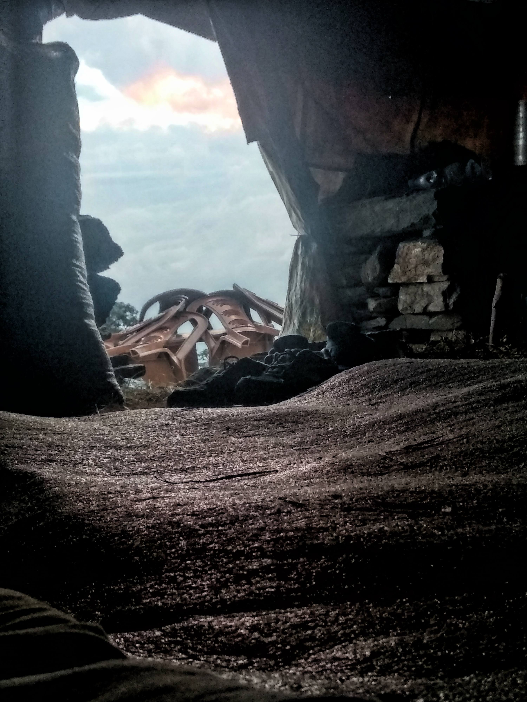

No one else arrived at our stay after us and thus we had the entire hut to ourselves. There was the owner who was also the cook and he prepared a sumptuous meal for us while his wood fired stove kept the entire hut quite warm. Content and tired we soon retired to our mattresses and crawled under warm and heavy blankets.

Flashes of lightning and thunderous sounds woke us up. We felt droplets of water spray across our faces. We both looked up and saw that part of the roof was flapping and the howling wind and rain was leaking through. Just outside, the owner was struggling to keep the flaps in place by the heavy stones which made up the wall.

Admist the heavy rain and hail, the owner managed to somehow tuck back the flaps under the stones . We couldn't sleep and waited for the storm to end. When it did end, we all took a peak outside. The storm had made the sky clear as a crystal and the night cold as ice. I envied the people who had decided to spend the night at Panar bugyal. The clear sky would have granted them heavenly views of the surrounding peaks reflecting the moonlight. Having been blessed with wonderful views through the trek, I guess I couldn't complain much.

We woke up early and freshened up soon. After a glass of scalding cup of chai, we started descending down the face of the mountain. We soon arrived at Mauli Kharak and realized that we were right in our decision to stay and Luiti the previous night. The number of people who had camped at Mauli Kharak were quite a few and it would've definitely been a crowded affair at the camps.

The rest of the climb down was without many incidences. We took about 5 more hours to reach Pung Bugyal, our first stop while climbing up. After resting there, we started again and reached Sagar in a couple of hours.

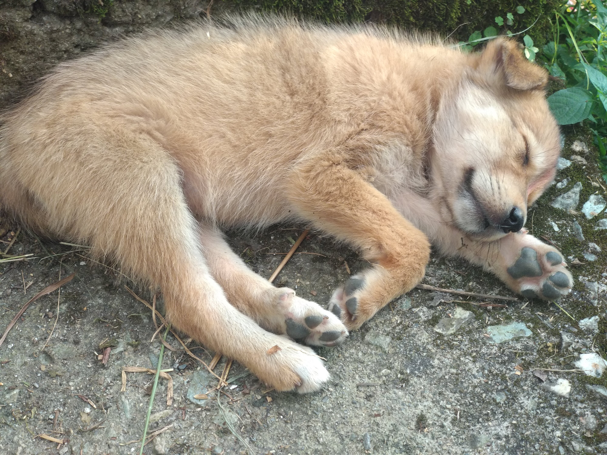

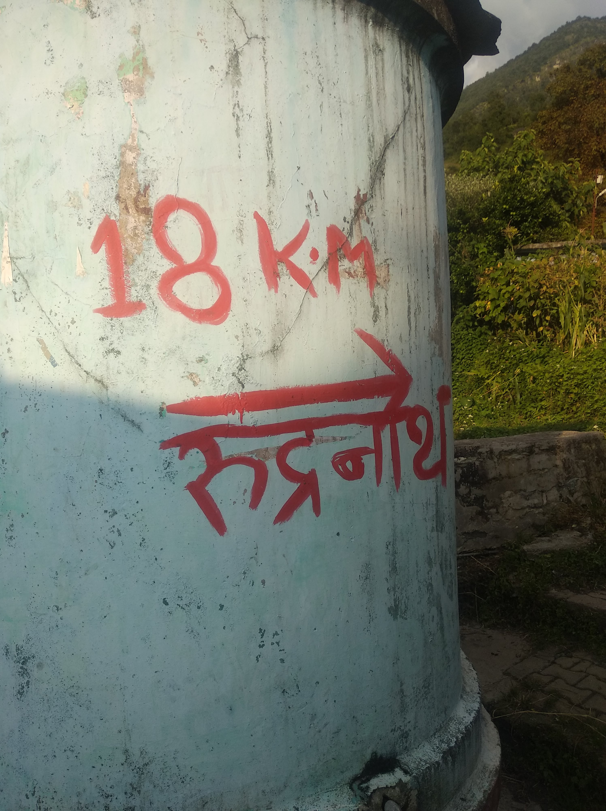

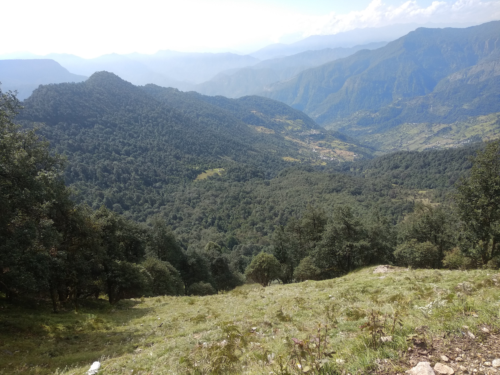

Looking back at the mountain, we still couldn't believe we accomplished the tasks that we had planned for months ahead. We proudly celebrated being deemed capable of taking on the Germans in battle!
