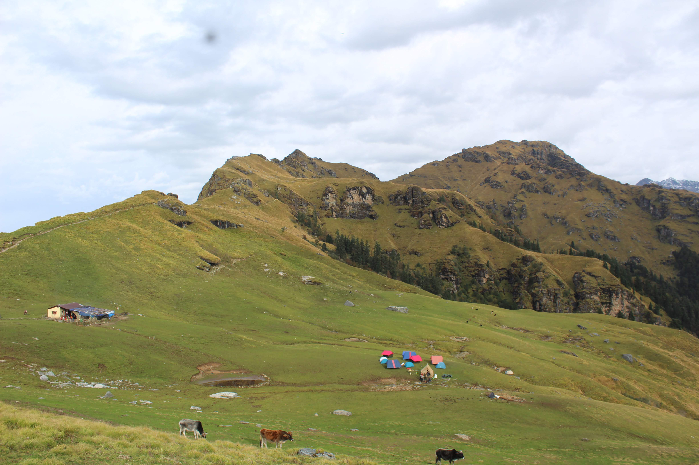
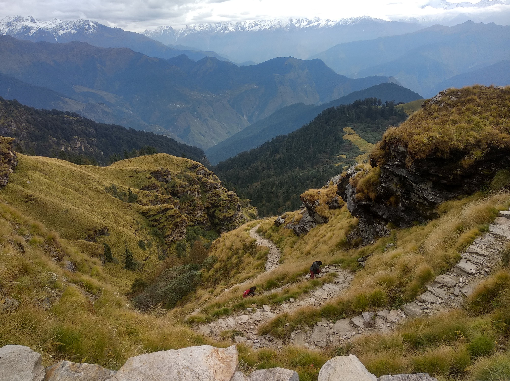
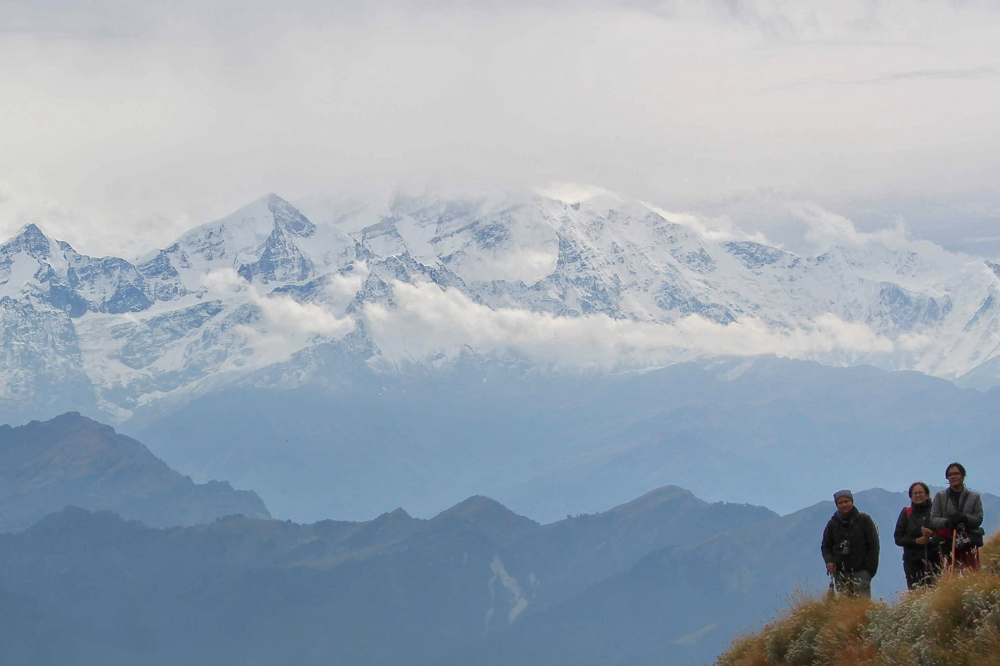
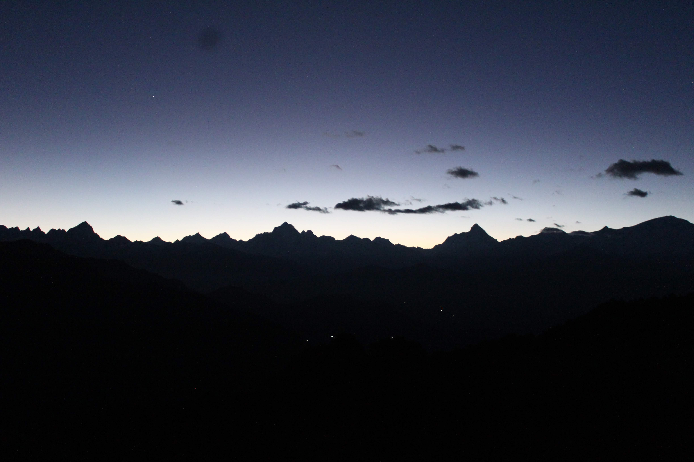
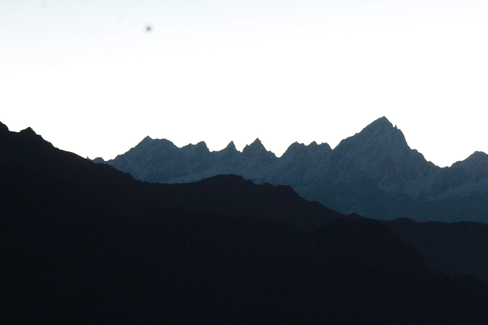
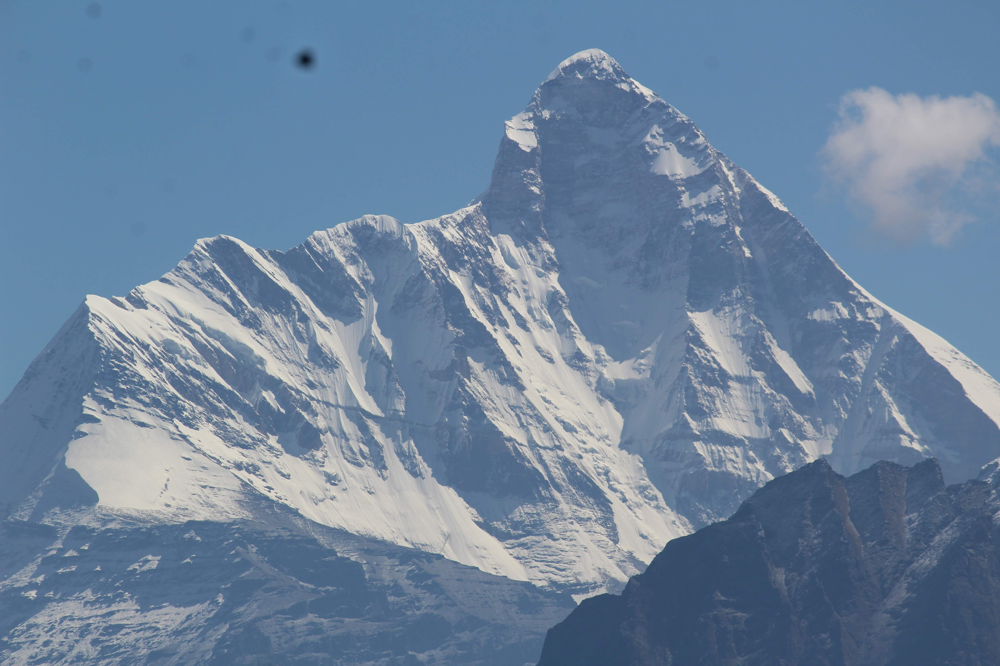

Having finally caught some sleep after shivering from the bone chilling cold most of the night, I started dreaming of the incredible vistas I had seen during the day. In dreams, one's subconscious usually comes up with images which are fantasy but obviously my brain had difficulty conjuring up images any better than the ones it had already seen the previous day. Thus all I could see in my dreams were the beautiful pathways I had trodden all day. These images seemed as unbelievable as they did during the day as they did in my sleep.

The dream ended and I woke up happily, completely aware of the fact that apart from my eyes being open now, nothing else had changed. I got out of the layers of (heavy) blankets and opened the door of our stone house which had kept the insides relatively warm. Stepping outside in the cold morning, the sight in front of me stirred a primal fear within. The sight of sharp and tall, humongous mountains forming an inescapable wall on the horizon intimidated me. Being afraid was the last feeling I had expected to encounter in such a divine place. I felt imprisoned.

However, fear turned into astonishment as my brain started processing the shapes of each of these peaks. I realized that I was being offered views of all the mountain peaks which had eluded me the earlier day. There it was, the mighty Nanda Devi, the second tallest peak in India and then Brahmkamal and also Dronagiri and wait, there was Trishul too! All presenting their silhouettes with the sun rising behind them. I had been in Uttarakhand for almost a year (and been to Auli thrice!) but hadn't been deemed worthy of a glimpse of Nanda Devi peak. However climbing all the way to Rudranath must have convinced the weather gods to bestow upon me this wonderful view!

 [Wikipedia](https://en.wikipedia.org/wiki/Nanda_Devi)")

 [Wikipedia](https://en.wikipedia.org/wiki/Dunagiri_(mountain))")

I got my camera out and clicked away. Gathering materials for more stories which I plan to narrate in the future.
As a bonus I also got to see Nanda Devi on my fourth visit to Auli!

