If you let go of expectation, more often than not you will be rewarded with a fulfilling experience. This holds true for movies ,books, life in general and as we'll see a bike trip in the Himalayas.

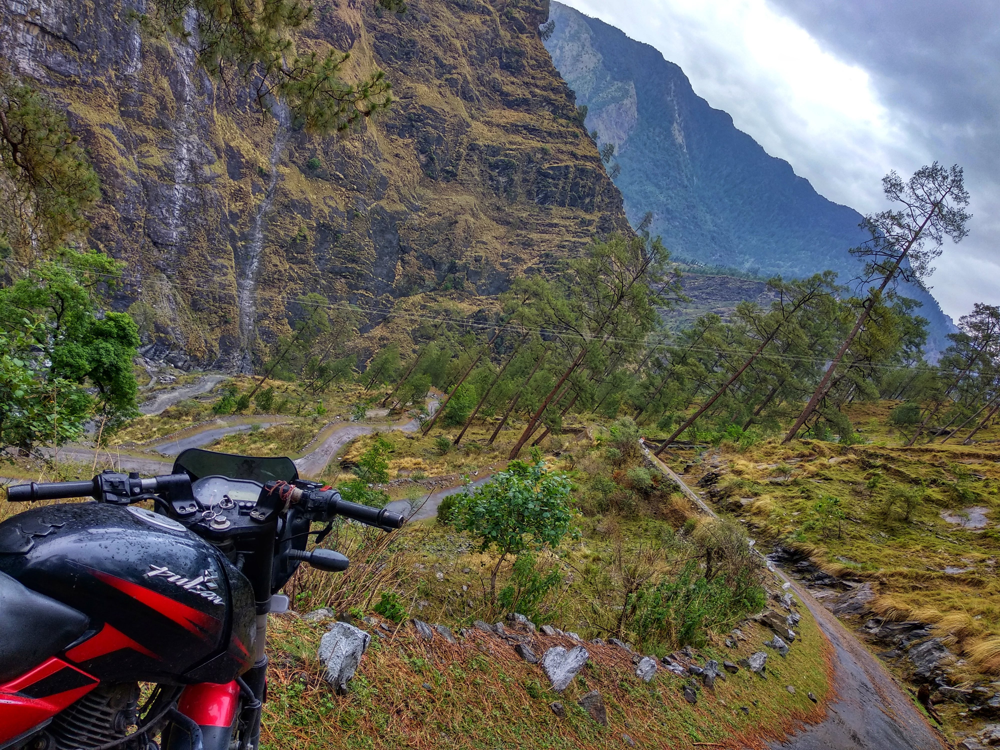

We weren't really sure where we would be going that sunday. Abhigna (*ma femme, mon partenaire*) suggested Kalpeshwar, a place I had no idea about. In fact for most of the places we visit, I rarely have any idea beforehand. I actually think that's a good thing and intend to keep it that way, as I am completely unaware of the things to expect and this makes the journey exciting not knowing what's lies ahead. However this time, my expectations were not neutral, they were in fact negative. Usually we would start early morning around 5-6 AM for any other place. However, we began this journey rather late, around 10 AM. The reason being the unwillingness to actually ride that far to a place we weren't really excited about. I was always looking forward to visit places high up in the mountains, where I could admire the peaks reaching for the stratosphere. However as Abhigna told me, this place was in a valley, Urgam valley to be exact. With the sole motivation of visiting one of the [Panch Kedars](https://en.wikipedia.org/wiki/Panch_Kedar), we started our journey.

")

It was a sunny day, though we had prepared ourselves for the unpredictable rains of the mountains and carried a poncho and raincoat with us. We decided to have breakfast on the way at a restaurant owned by one our colleagues of our college. He too was at the restaurant when we reached there. He told us about his experience of visiting Kalpeshwar. He made sure that he gave us enough warnings about the road to that place. The roads were just for namesake. They were actually paths lined with loose gravel and the occasional boulders, with very high gradients which only got worse when it rained. He himself had taken many a fall while riding up that road. Knowing my capabilities as a bike rider, this got me worried. I hoped he was just exaggerating and things wouldn't be so bad. It was only a matter of a few hours for my hopes to be dashed. But the hours leading up to that moment were enjoyable thanks to a bright and sunny day.

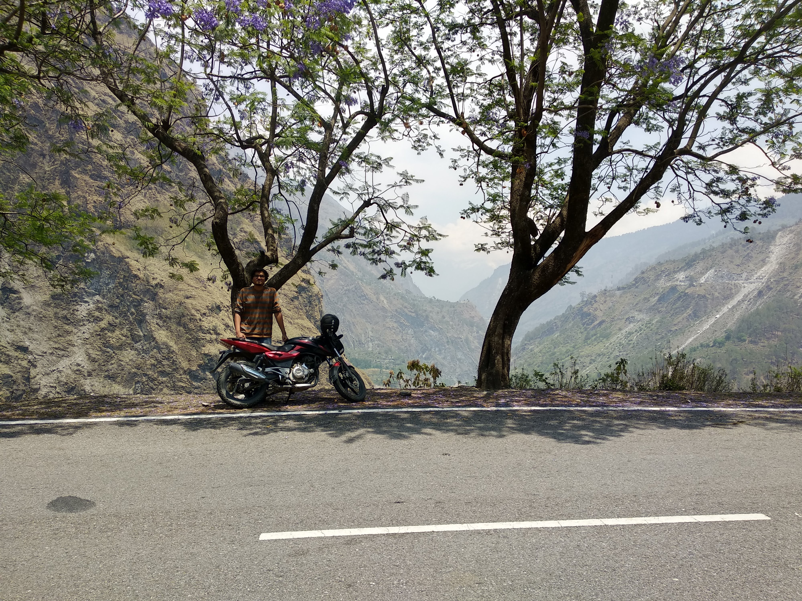

We knew we had to get Helang and then cross a bridge to begin the ascent on the road to Urgam thus starting the main part of out journey. In order to cross a river and get to the other mountain, you have to descend, cross the river on a bridge and then ascend again. It may be trivial for many people, but I only realized this once I started living in Gopeshwar. We didn't actually know, where on the highway the road that descended towards the river lay. Asking many people on the way, we were eventually sent along the right direction. On an earlier trip to Auli, I had seen the temple (Red monument near the center of the image below.) from the highway and asked my driver about it. He informed us that, that road is very treacherous and specially that turn. There had been so many accidents that locals had built a Lord Hanuman temple on the turn to protect the travelers. I did not know that one day I myself would be going down that same road.

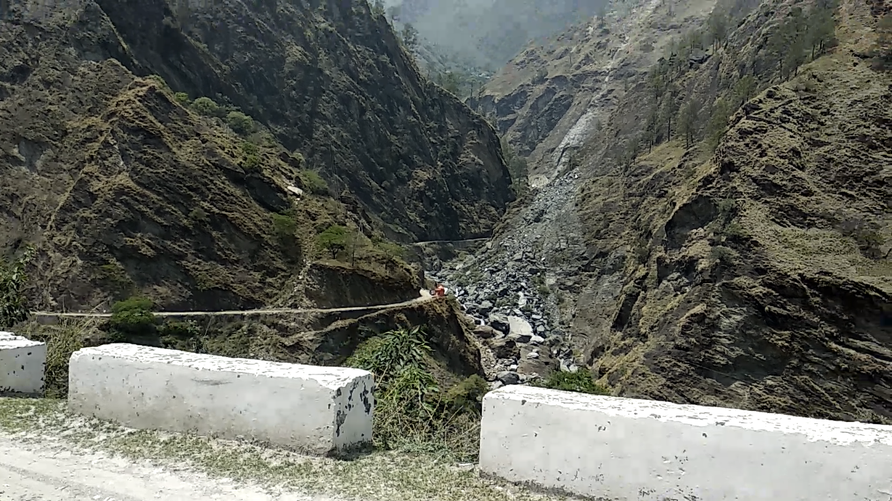

We took the highway exit and started going down the road. The quality of the road had already started deteriorating and looking ahead it seemed that it would get much worse.

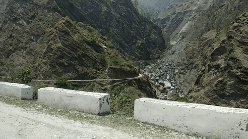

We descended on our side of the mountain and approached the bridge that would take us on the mountain on which the Pandavas had chosen to build one of the five temples dedicated to Almighty Neelkantha. Since the roads had worsened in quality as we approached the bridge, my capabilities as a biker was put to the test.

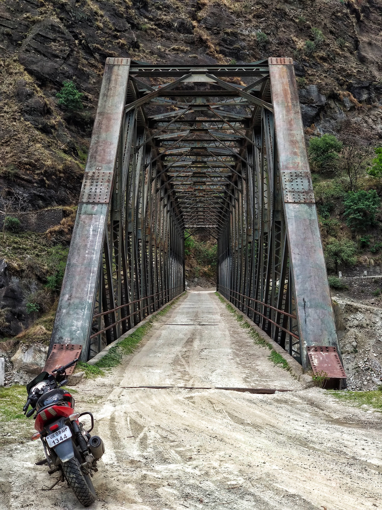

I failed the test as soon as it started. As we approached this bridge, I thought we should stop here to take a look at the roaring Alaknanda. However, not paying attention to the thick layer of silt on the road, I applied the brakes, the bike skidded and we both took a fall. Dazed and confused, we got up, picked up the bike and contemplated that maybe we should head back. After all I couldn't handle a simple change in terrain. But Abhigna had faith in me and she convinced that we should in fact continue since taking a fall at the starting itself would make me pay more attention on the roads to come. Up ahead, the Hanuman temple was visible. We prayed for protection proceeded towards the turn.

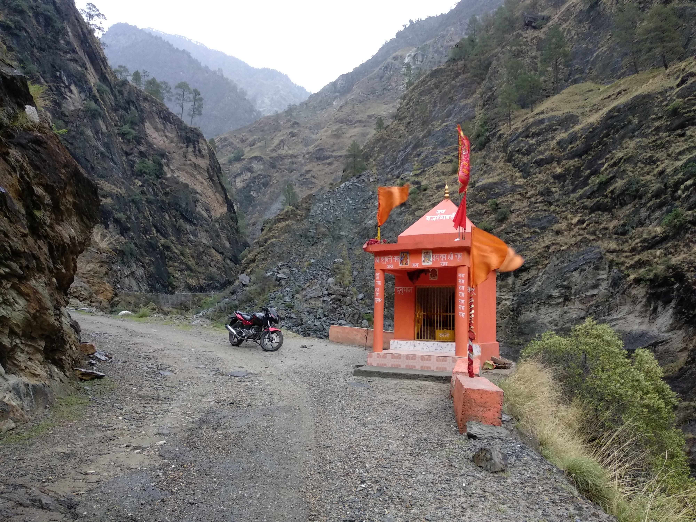

We took the turn and once again, both of this time, doubted if we should continue the journey. The road ahead was full of rubble and sloping upwards at a steep gradient. We were so tensed and worried about the upcoming ride that we didn't take any pictures. So you'll have to trust me when I say the road really was treacherous. If you ask around in Garhwal, you'll find many people agreeing with our views. Already having taken a fall in the beginning, I was filled with trepidation about the riding my bike. I went ahead with the bike engaged in the first gear. However the bike started slipping backwards because of the rubble. Maybe an experienced biker could have handled it better. Fearing a fall again, Abhigna decided that she would climb down and walk up the slope while I alone rode the bike. This we made the first part of our ascent. Just beyond the slope we heard a thundering sound.

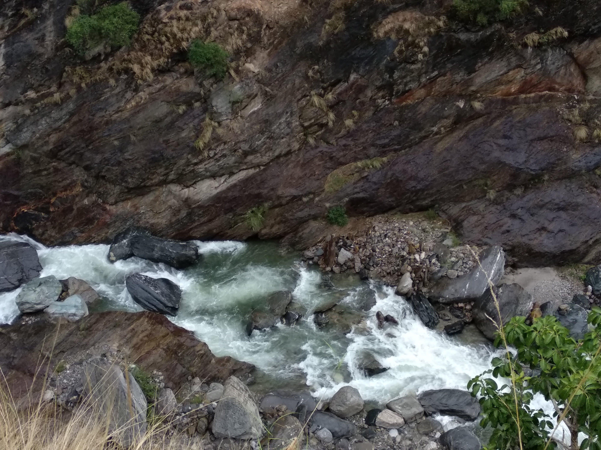

We parked the bike and looked over the cliff, it turned out the sound was caused by water flowing in a big pipeline. It was most probably part of a small run off the river hydraulic power plant. The water was being discharged into a clear river that we later learned was called Kalpganga. We decided to head back up the road. By now the weather had changed and it seemed that rain would soon accompany us. We continued, riding very slowly and never going above second gear. We rode for about an hour.

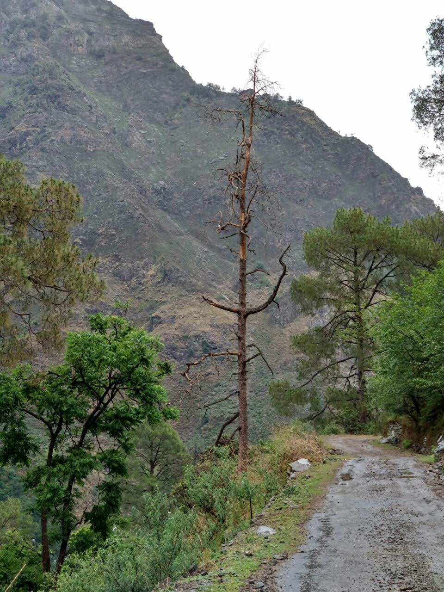

The journey from there onward comprised of broken roads, roads filled with rubble, roads submerged by mini-waterfalls flowing down the mountain side, muddy roads. In short all the types of roads you could test your caliber as a mountain biker. Unfortunately I was neither a mountain biker nor was our bike a rough terrain bike. It was fun nonetheless. We approached dangerous parts of the road with a fast beating heart, and once we were through it, the adrenaline rush of the experience made the hardship count.

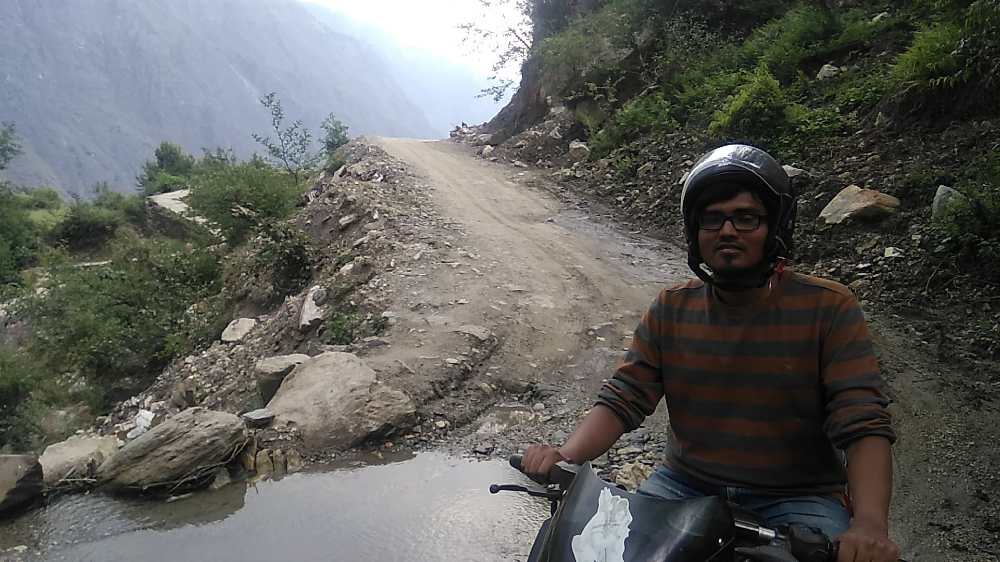

Finally we reached a place, where there were other cars, jeeps, parked on the side of the road. Asking around, people told us that the road ahead is not drivable. Thus it seemed we would have to walk. We regretted having not started early. It was already quite late and walking would cost us more time. I was also fearing our way back. The path also passed through jungles and I felt scared thinking of the consequences of having to drive down that treacherous road in the dark. But since we had reached so close, there was no turning back and we decided to continue.

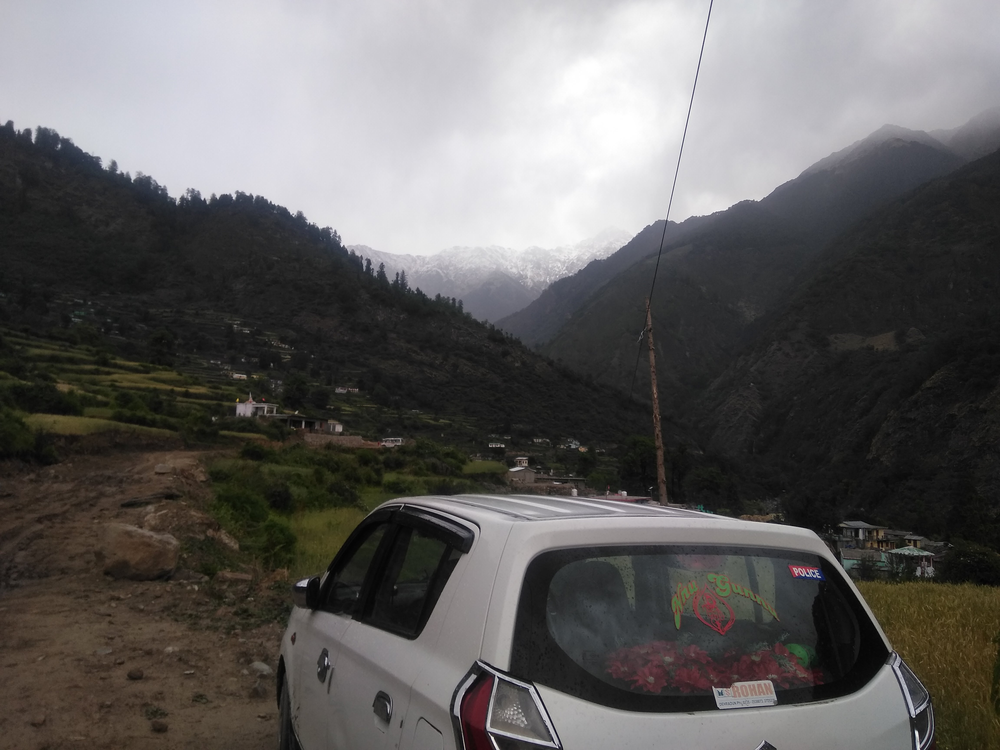

We parked the bike on the side of the road and began our walk. One of the many wonderful things about Uttarakhand is the nature of their people. In any other place I would have been worried about leaving bike parked in an isolated spot, where anyone if they wanted could have broken the lock and rode off. However, my experience of living here for the last few months comforted me and I knew the locals could be trusted and my bike would remain there unharmed even if I came back after a few days.

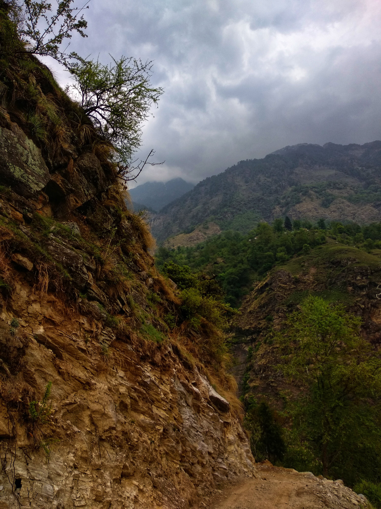

The sky was beginning to darken and we didn't really know how far ahead the temple was. The path turned a corner and soon we were walking through a jungle. It had begun to drizzle lightly, but we were protected under the cover of trees. After a few minutes walk, tress gave way and we were greeted with the views of a beautiful waterfall, falling from a tremendous height. It seemed that all our troubles would be worth it. However, this was only an introduction of the things to come. We would soon be rewarded with many more surprises.

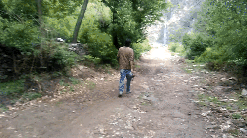

We paused for some time and admired the waterfall. At first we thought that the small white structure seen in the image below was the temple for which we were destined. This worried us instantly. We were certainly not prepared for such a steep climb.

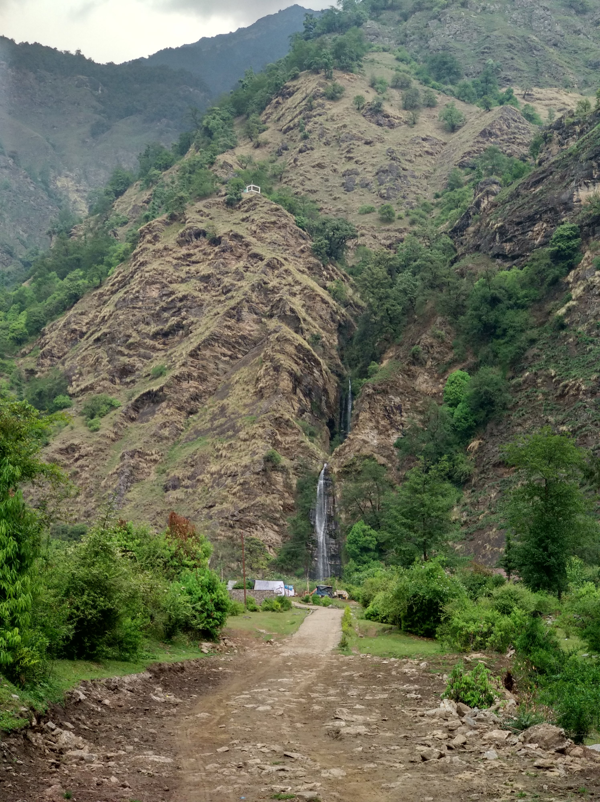

Walking a few more steps showed us the path of our true destination. Although the place itself wasn't visible yet, we were welcomed by the Uttarakhand Tourism signboard, acquainting us with the history of the temple and its other important facts. We decided to rest for a few minutes and take some pictures. After all the temple couldn't have been much further away from the Tourism signboard.


img_20180513_144945_hdr-2.jpg
img_20180513_145003_hdr-2.jpg


We took off soon as we were eager to reach the temple. After a few minutes, we could see the temple on the other side of a small gorge. However there was a minor problem. It seemed that there was no means to get to the other side.

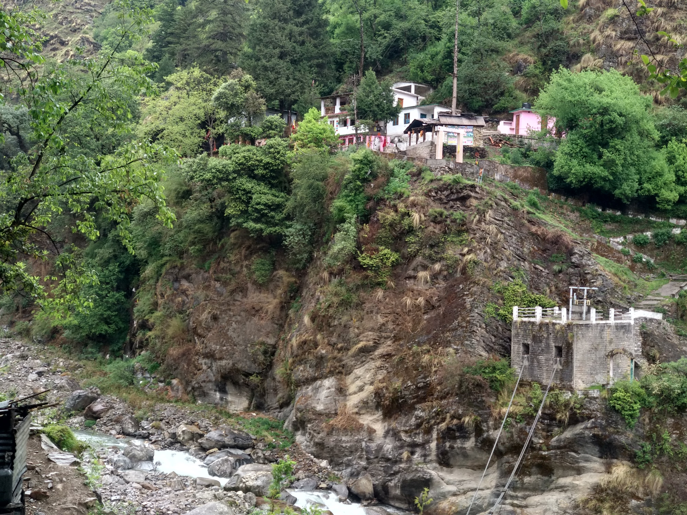

The bridge that would allow us to cross the river, Kalpganga flowing in the gorge was devastated. Another means of crossing, a small cable car, was also abandoned. It had also started raining heavily and we needed to get to the temple soon.

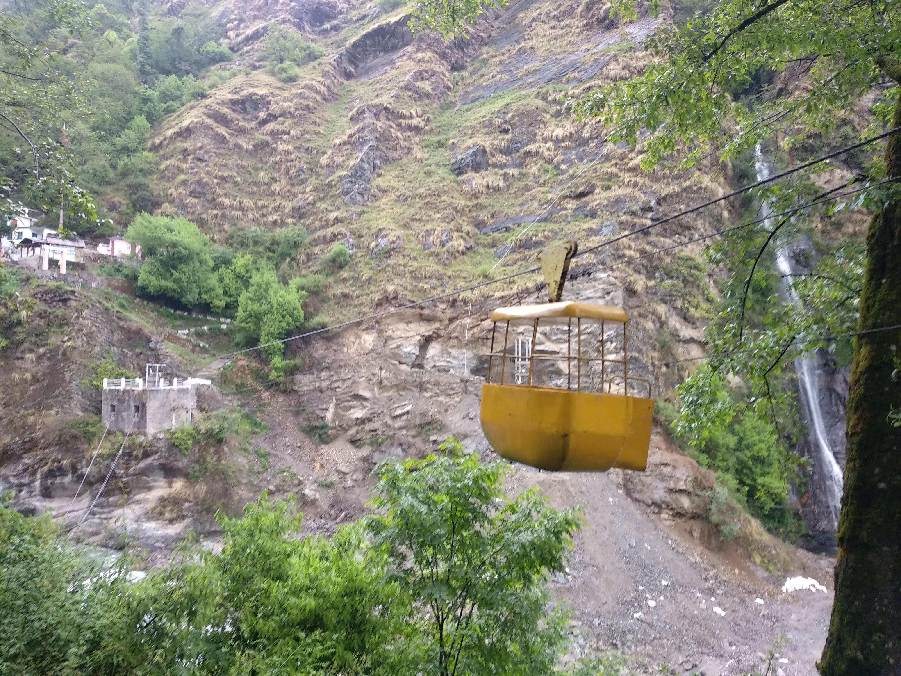

Walking a bit further, showed us a path that descended down to the river. It was then that we could see a makeshift bridge of logs and chains on a part of river where it was the narrowest.

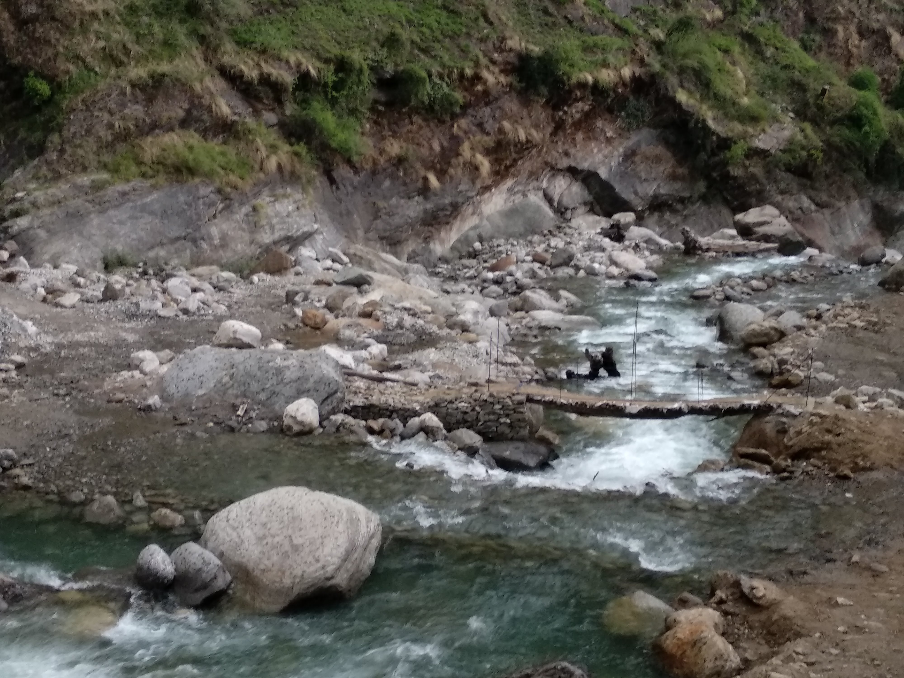

Out of excitement and in order to get shelter from the rain, both of us made a run for the bridge. However once on the bridge, we stopped for a few minutes to admire the river and take a few pictures.

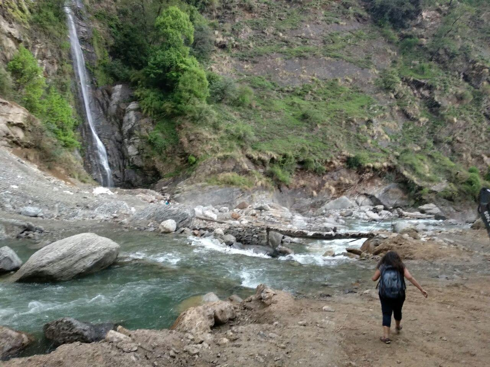

We could also see the waterfall closely but we decided to visit it on the way back. Now we had to go back up the gorge. We started looking for a path and in a few minutes realized that no well defined path existed.

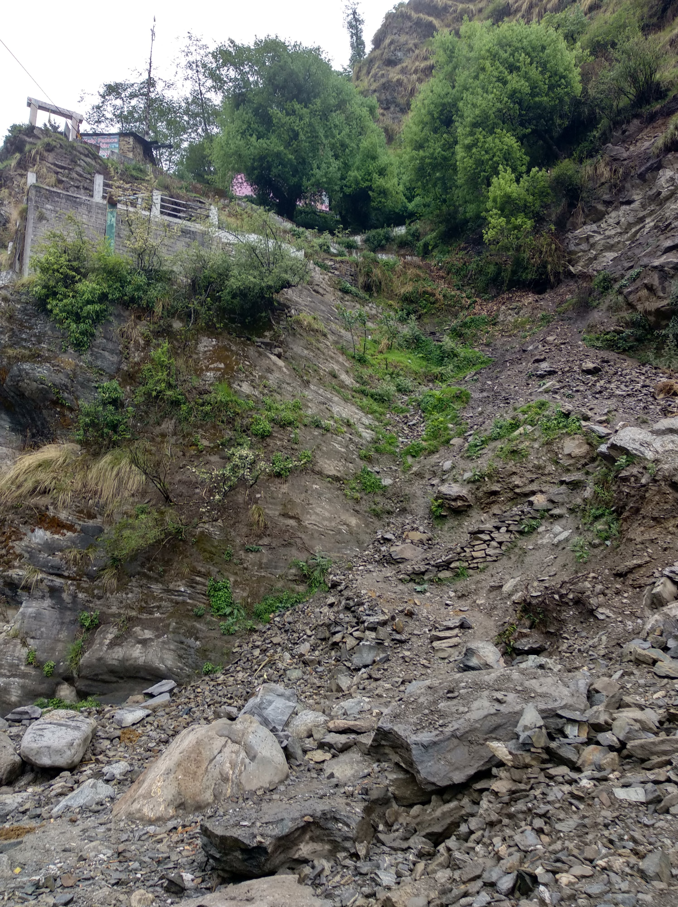

We knew the only way up was on a steep muddy slope made slippery now due to the heavy downpour. Helping each other we made our way up slowly and steadily.

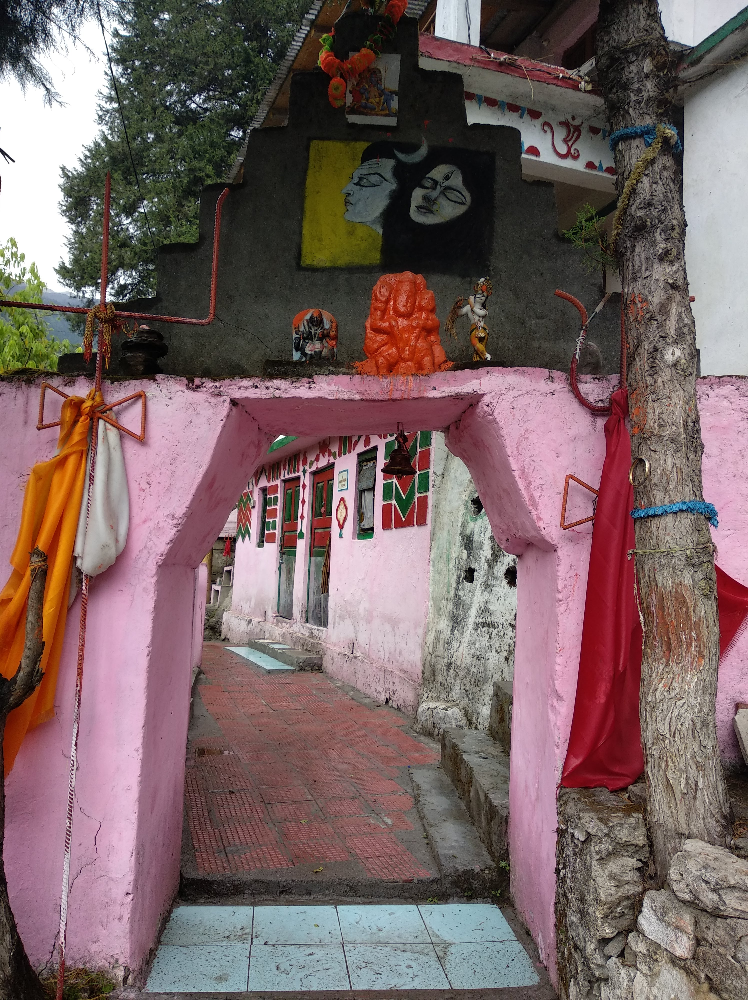

It took us some time but eventually we made it to the top without any mishap. The rains had intensified and we ran inside the temple seeking shelter. A priest seemed to be waiting for us and welcomed us wholeheartedly. He asked to take off our ponchos and raincoats and leave them on the corner to dry. He requested us to take some rest and when ready to follow him to the small cave within which lay the holy Shivalinga.

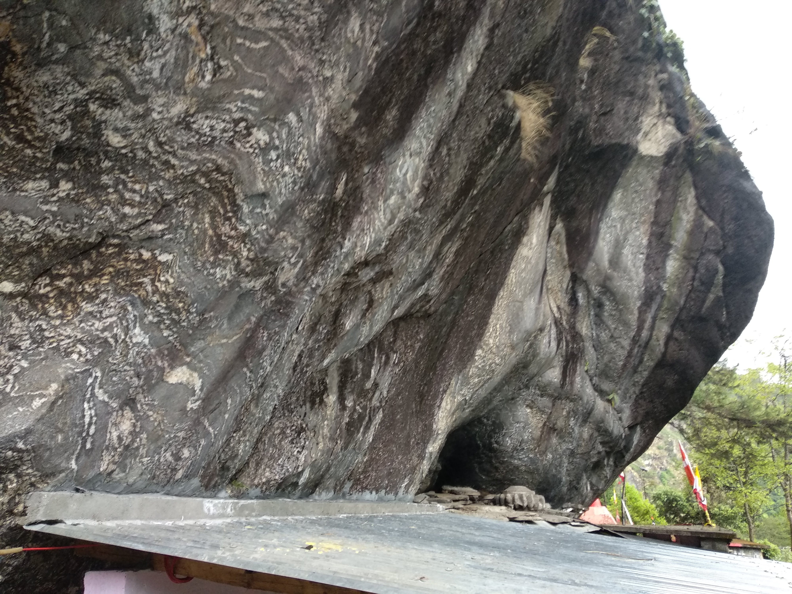

We were exhausted so we sat down for a while, resting and drying ourselves. The place seemed magical and heavenly. The temple was almost empty of visitors. In fact apart from a few sadhus in a hut next to the temple, we couldn't spot anyone else. It seemed we three, us and the priest, were the only ones in the temple and this gave us a very special feeling. The dark clouds had transformed the sky and the heavy sound of rain and of the rapidly flowing Kalpganga below the temple gave us an experience of bliss never felt before. I haven't forgotten that experience till date and revisit that time in my memories quite often.

")

After a few minutes rest, we followed the priest to the sanctum sanctorum within the cave. It is hard to put into words, but the feeling of being inside the cave surrounded by diyas and flowers and The Shivalinga in the center along with other deities while thunder roared and heavy rain lashed the roof was exceptional and spiritual. The cave provided the much needed warmth and all our tiredness left us, while our mind became calm and our hands folded in reverence to the mighty Byomkesh and his hair (Jata) engraved in the stones above him for which the temple is named. We performed the puja, guided by the priest. He applied a thick paste of Sandalwood paste across our foreheads in the process. The aroma and the coolness of the paste soothed our minds.

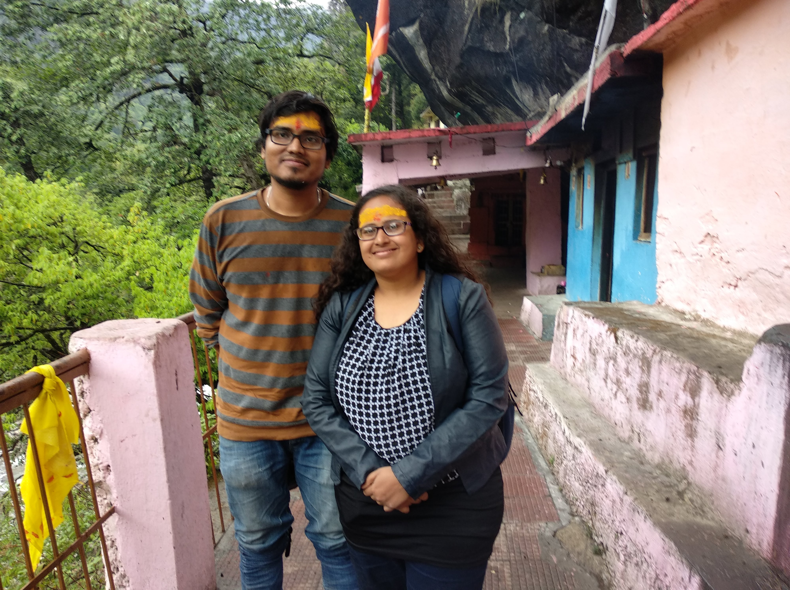

Being from the city, my mind has been corrupted mostly because of bad experiences. While the Puja was going on, in my mind wandered the thought, that since the priest was so sincerely performing the Puja, he must be expecting a good amount of *dakshina* once it was over. I had learnt to expect to haggle with priests in temples and thus my expectations were the same. However, this wasn't the case here. The priest performed the Puja as part of his duty and didn't seem to expect anything in return. I handed him some money and he took it with gratitude hardly paying any attention to its amount. The people living in the difficult to reach places of Uttarakhand have been spared the cunningness that infects the city folks living in the plains.

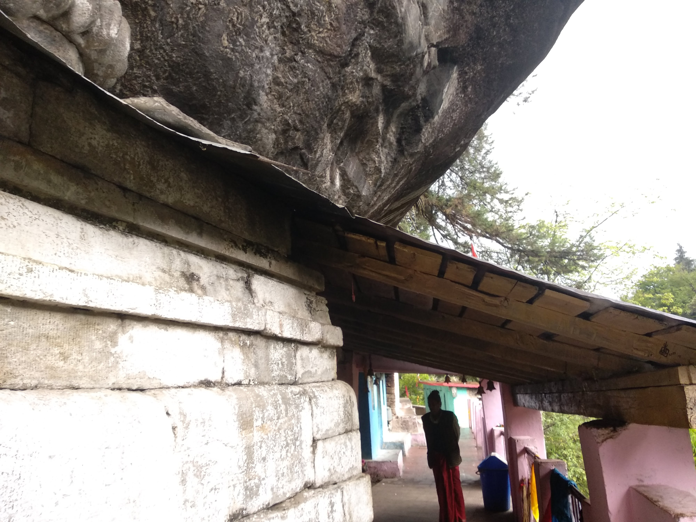

We started a conversation with the Priest regarding the bridge, and he informed us that the bridge had collapsed during the floods of Uttarakhand in 2013. He invited us for a tea at his dwelling and we gladly agreed. He laid down some mats on the balcony outside his room and invited us to rest while he prepared tea inside. In a few minutes he was back with steaming tea for the three of us and we sipped and chatted away taking in the surroundings and hoping to carry this moment in our hearts forever.

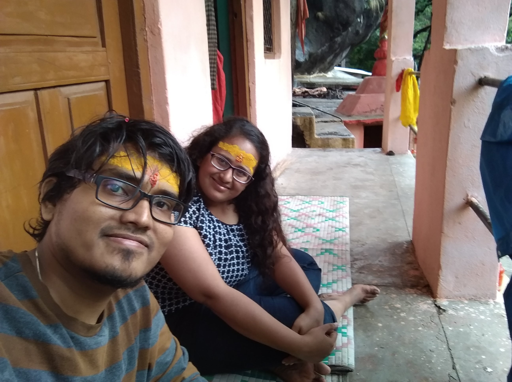

The priest suggested that we should stay the night at a rest-house in the village since it was getting late and we may have trouble reaching home on time. However, we had a job to get back to as the next day was Monday. Also there wasn't anyway to inform our home owners that we wouldn't be back at night. From the moment we entered the path to Urgam valley, our phones were devoid of any signal. Thus with no other option available we decided to head back. We also wanted to spend sometime at the waterfall so we took the leave of the priest, prayed one last time at the temple and descended down the dilapidated path.

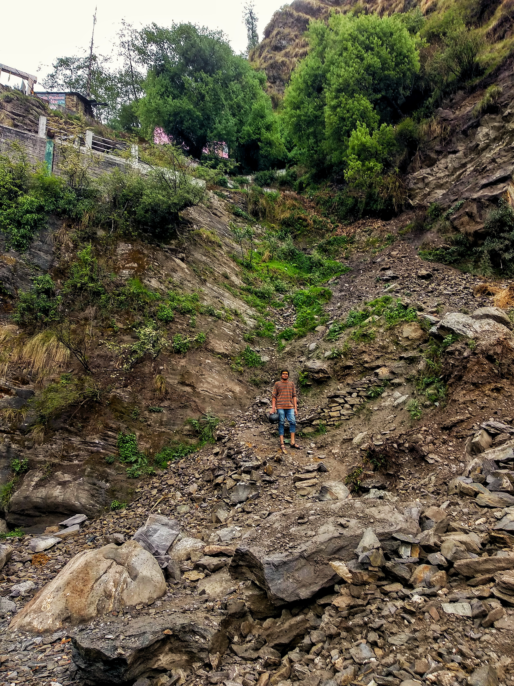

Soon after getting down, we headed for the waterfall. Water was flowing rapidly down the slick black rocks and spraying us, thus drenching us even more. We wandered around the fall, listening to its thunderous sounds and posing for a few pictures.

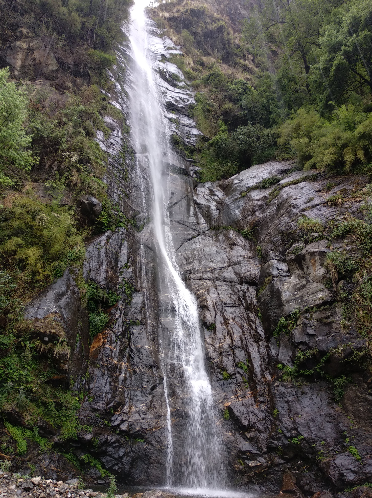

We also spent some time inspecting the ruins of the destroyed cable bridge. The river must have overflowed to quite some height for it to be able to destroy the bridge completely. Throughout Uttarakhand you can still see remnants of the destruction caused by the 2013 floods. We took some more pictures for memories and then hurriedly made our way up the gorge on the other side.

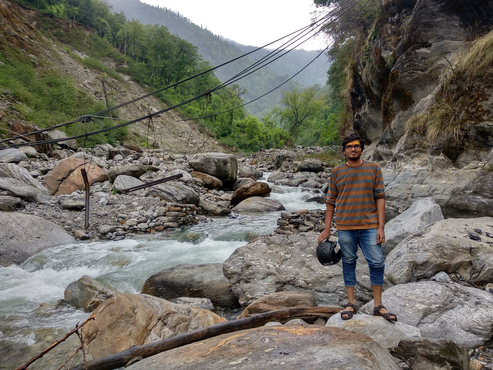

We walked quickly as the light had started dimming. However in this low light we could clearly see some of the snow capped peaks sparkling up ahead. We thanked the gods for opening up the skies just enough to allow us these otherworldly vistas.

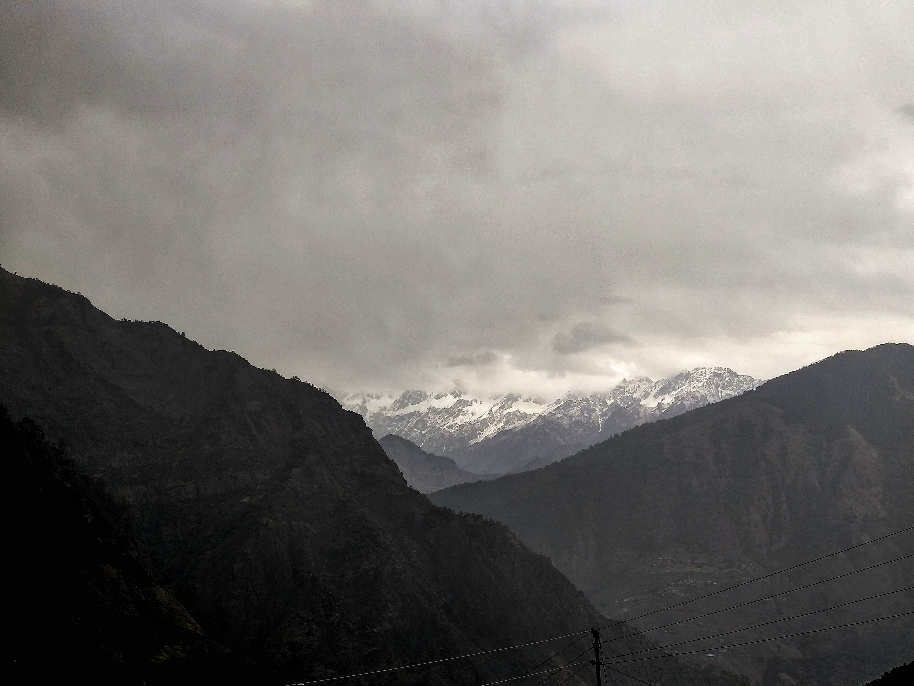

We came to the place where we parked the bike and sure enough it was right where we left it. We got on the bike and took some more pictures and then finally bid the place goodbye.

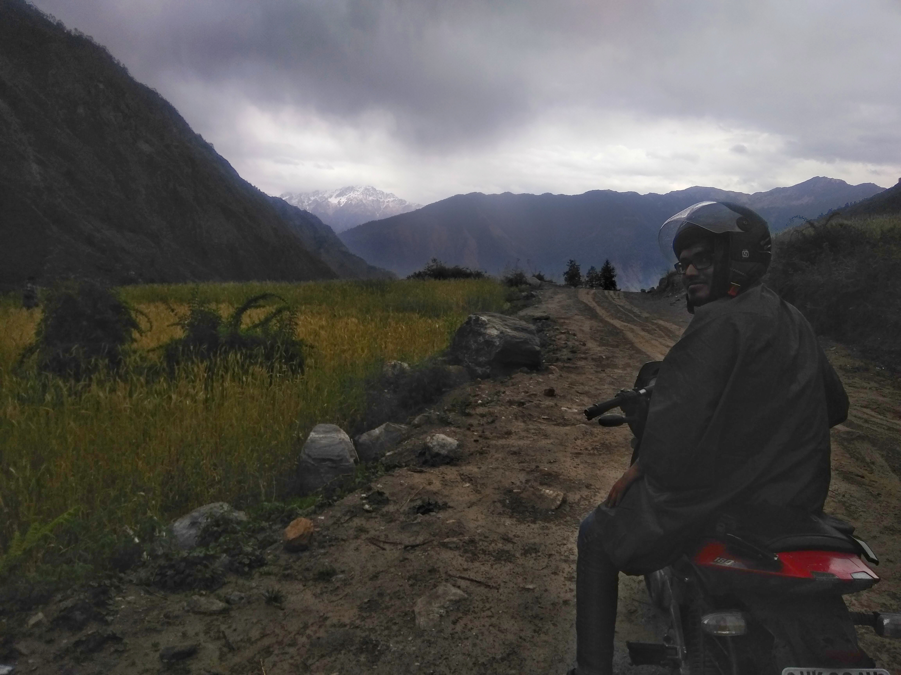

The path back was covered without any unusual incidents. However there is one thing which clearly stood out in the last part of the journey. While descending down the mountain as we approached a hairpin bend, an exquisite scene presented itself to us, almost like a parting gift. The whole of Urgam was visible with high snow capped mountains in the background. It felt magical. I regretted not having brought my DSLR camera. I wanted to capture it in as much details as possible. I did what I could with my phone camera.

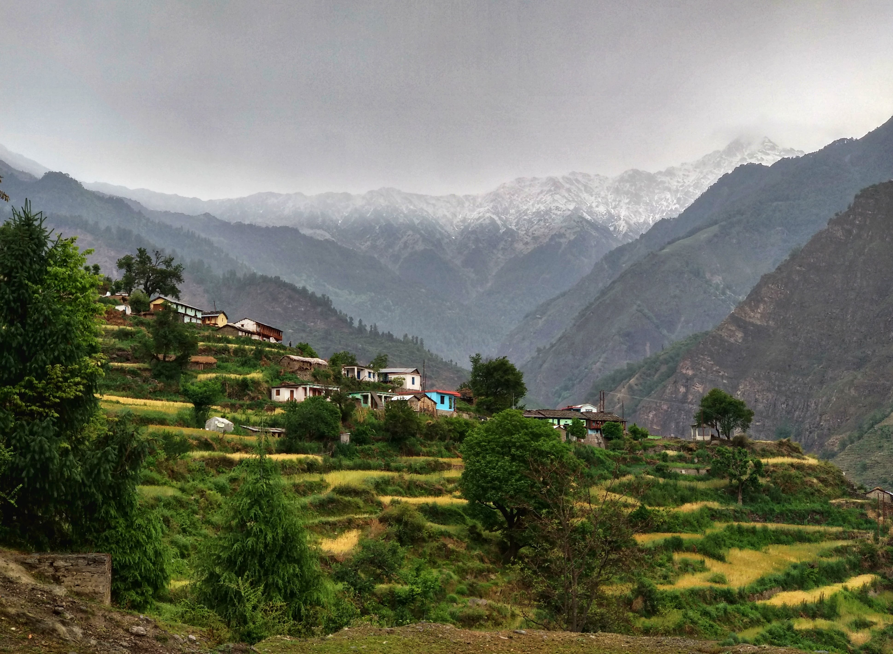

We wanted to stop for a bit longer but the approaching night worried us and we soon got back on the bike and continued our return journey.

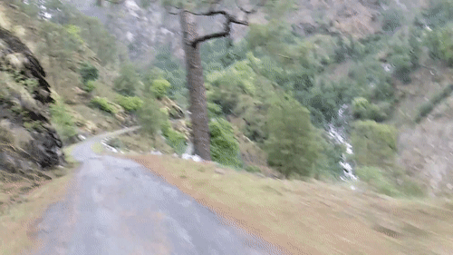

We reached the lord Hanuman temple on the treacherous bend and stopped there for a while to appreciate the confluence of Kalpganaga and Alaknanda. The river Alaknanda meets many such companions on its way and finally takes the identity of Ganga after meeting Bhagirathi in Devprayag.

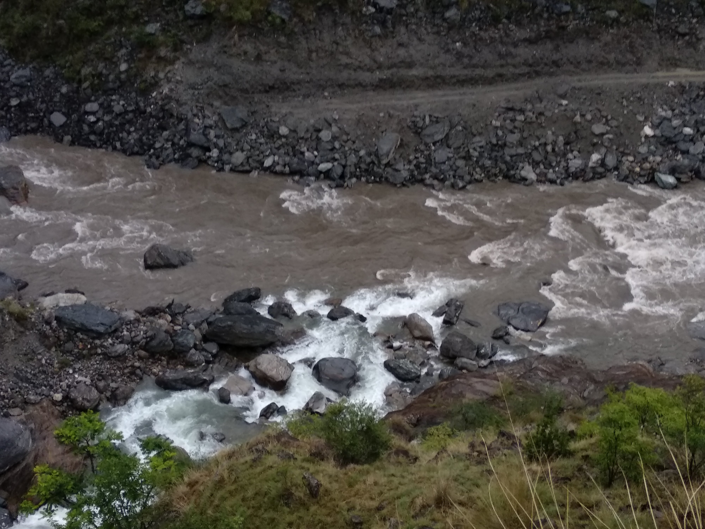

While we were admiring the views, we saw another person nearby who seemed like he was from the army. Upon inquiring he confirmed our assumption. He had stopped there to perform Puja in the temple. We joined him and thanked lord Hanuman for keeping us safe throughout the journey. Apart from the fall at the beginning, there had been no other untoward incidents. We took one last parting picture with the bike next to the temple and crossed the Alaknanda river to head back home to Gopeshwar having a stomach devoid of any food and a mind filled with memories.

After almost a year we went back to the same place with my parents. We had no difficulty crossing the gorge this time.

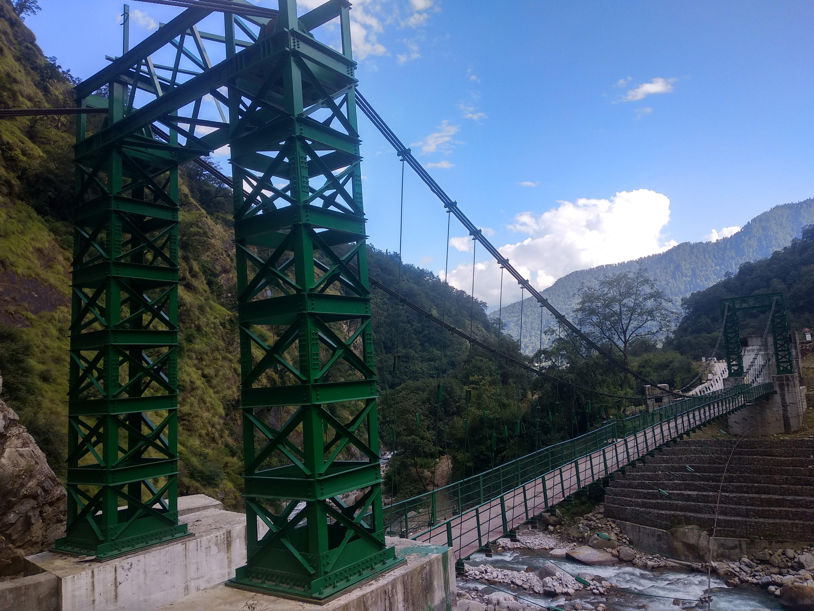
