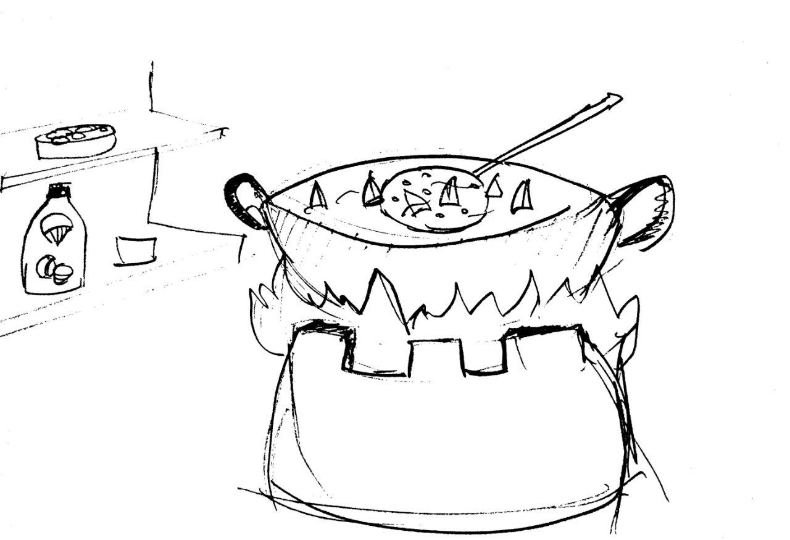
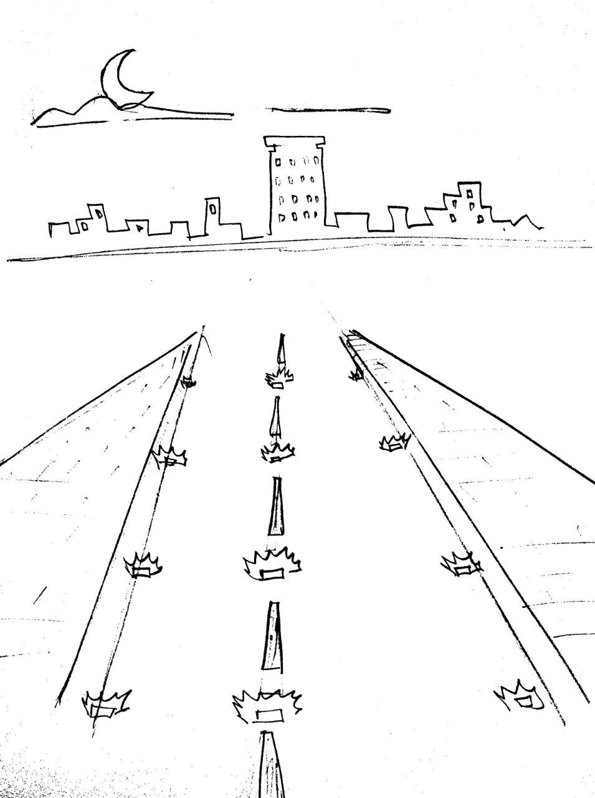
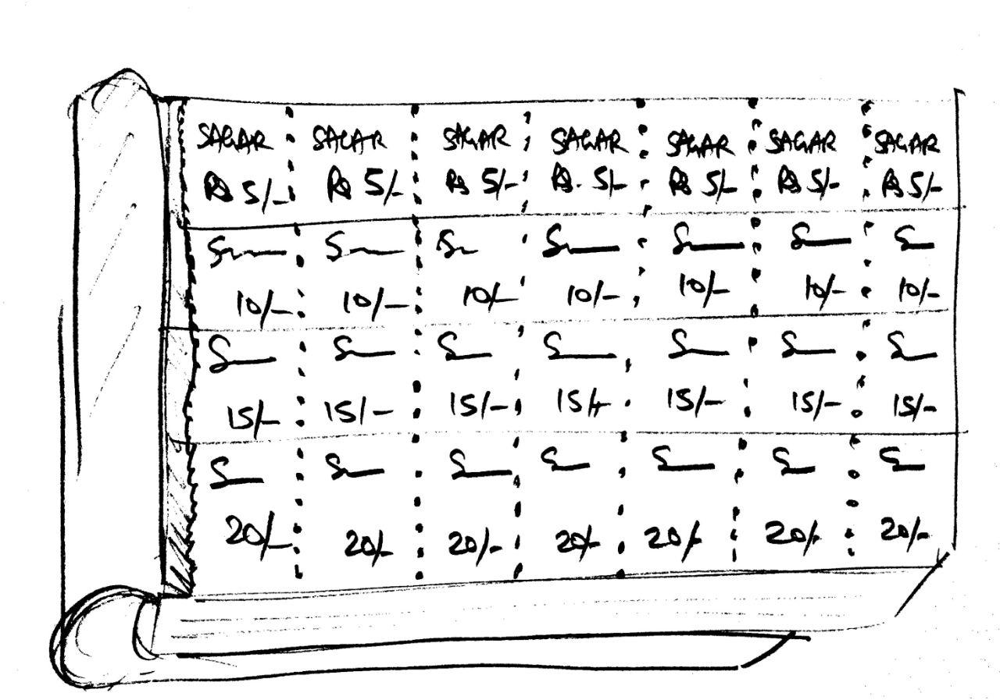
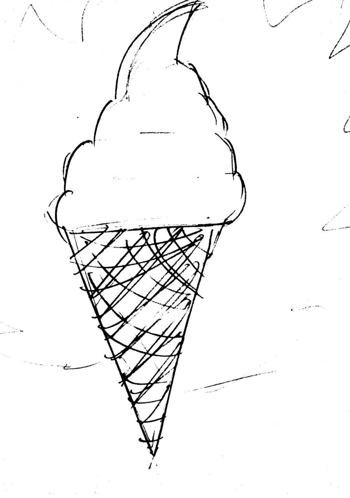

The faint aroma of samosas being fried was making me impatient. It takes forever for the Samosa to reach the magical golden brown. The halwai seems to tease you with his ladle motions and just when it seems that he is going to take the bunch out of the humongous kadhai, he puts them back in.

I was ready to wait.

Finally I was served a plate of crisp, hot samosas. I picked them up with reverence and proceeded to perform the chutney dipping ritual. However, I wasn't ready for the sacrilege laid out on the plate. The place of Imley chutney was taken by a white paste. Outraged, I inquired the halwai about this unholy act. He glared at me and mumbled something in a language I didn't understand. He then casually took a bottle of Parachute coconut hair oil and poured it completely into the kadhai, while I watched in utter horror and started shaking uncontrollably in disbelief.

"Wake up, we are about to reach Chennai", said my mother while shaking me to wake me up. Oh, what a nightmare it was! Having to see my most favorite dish treated in such a way probably scarred my mind and my appetite for the rest of my life.

The train stopped at a platform and vendors went up and down the aisle introducing their wares in the most unusual way like always. I wondered if someone actually sold something announcing the name in a normal way, he would definitely be ignored.

Anyway I was listening to each one of them with concentration, trying to decipher the words so as to decide if they actually were of any interest to me.

"Chaaaiii....", No!, "Paaeeper....", Boring!, "Vadae....", I wonder what that is? This went on for a few minutes and it seemed that none would receive my business or my father's to be precise.

"Saaamosees…", the magical words were uttered at last, although heavily distorted. These words cast a spell on me and caused me to throw my hands excitedly, stomp my foot and perform a small song and dance routine in front of my mother. She was impressed and decided to convey my demands to my father. He was in a good mood and agreed. And thus we were presented with 4 pieces of Samosas, my sister reaping the rewards of my hard work. There was no chutney on the side, which was actually a relief. I hadn't forgotten the dream yet, albeit the mental scar was quickly replaced by the sight in my hands.

I took my piece and gobbled half of it in one bite. But wait, there was something wrong. I couldn't feel the softness of the tangy potatoes. Instead I felt something crunchy within my mouth. I took a piece out. Onions!? I looked at the other half of Samosa in my hand. Only onions!!! The travesty didn't end in my dream. I was living the nightmare!

My friends back in Bihar were right after all. This really was a completely foreign land. My friends, if they deserved to be called that, took a lot of enjoyment in describing the way my life was going to be turned upside down in Bangalore. Even the name sounded like nothing I had heard in my respectable life experience of 10 years. They all seemed very knowledgeable on the subject and specially so in the matters of food.

"They cook everything in coconut oil!"

"Forget about eating your favorite food, now it's all going to be coconut dishes fried in coconut oil and served with a side of coconut chutney!"

It was these conversations that were tormenting my dreams. I hoped that they were exaggerating. However, my first experience of Samosa in South India had made me doubt my optimism. After all, I had expected the recipe for Samosa to transcend the borders of states and countries. With these thoughts in my mind I myself transcended the border of Karnataka from Tamil Nadu and moved closer to the place, where I would be spending the next decade of my life.

We reached Bangalore late at night. I was woken up from yet another one of my gastronomic nightmares. We got down at the Bangalore Cantonment railway station. I wondered if it had something to do with canteen and food but I was too sleepy to think about these things in detail. We got into an auto and left for our destination. It seemed that I was still half asleep as I could see roads blinking with lights in the center and at the sides. Surely this was the stuff of dreams. I didn't want to waste any effort in dreaming with my eyes open. Thus I closed my eyes and fell into a deep slumber.

I accompanied my father the next day to run some errands. We were to catch a bus from Ulsoor to Majestic. Making sure that I remembered where our home was in case I got lost, he took me to a restaurant for lunch. I looked up at the menu searching for my favorite delicacy. It seemed apart from the spoken language, the language of the belly also differed here. The only food item I could recognize was dosa, having eaten it once on our family trip to Odisha around 1995. I gave up any hope of finding samosas among such foreign cuisines.

Dejected, I turned around. My father handed me a small paper coupon, with Rs 5 written on it. It really didn't seem like a good time to fool me with paper money. Before I could protest I saw the cashier having a whole book full of them and people happily exchanged money with these pieces of paper. Perhaps I would understand these rituals better when my school started and I was trained in the local behavior.

What are you waiting for? Go get the ice-cream before the queue gets long.

Oh so that's what it was for! I hurried along and joined the queue.

The operator kept the cone under the nozzle of the machine and out came the cream. One turn, then another one on top, followed by a third. The stack seemed unstable, I was worried it would fall and I would get none. However he turned it around the fourth time and then detached the cream from the machine. All this for Rs 5!

Perhaps it wouldn't be so bad here in Bangalore after all.
