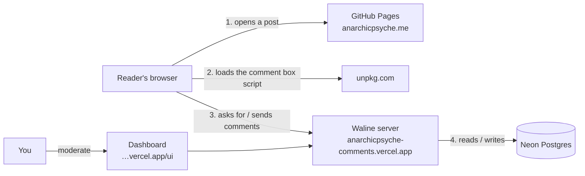

# How comments work

Readers can comment at the end of every post with just a name: no account, and email is
optional. This page explains what was set up, why each piece exists, and how to look
after it.

## The short version

The blog is a **static site**: GitHub Pages serves ready-made HTML files and can't store
anything a reader types. Comments need somewhere to be **received and saved**, so two
free services were added next to the blog:

| Piece | What it is | Where it lives |
|---|---|---|
| **Comment box** | A small script that draws the form and the comment list | Loaded on every post from `unpkg.com` |
| **Comment server** | [Waline](https://waline.js.org), a program that receives, checks and returns comments | Vercel project `anarchicpsyche-comments` |
| **Database** | Where comments are actually stored (Postgres) | Neon, Singapore region, linked to the Vercel project |

1. A reader opens a post. GitHub Pages sends the page as usual.
2. The page loads the Waline comment box script.
3. The box asks the Waline server for this page's comments, and sends new ones there.
4. The server checks each request (right website? spam?) and reads or writes the database.

## What each setup step did

These are the steps you did in Vercel and Neon, and why each one was needed.

1. **Cloned the Waline template on Vercel.** Vercel created a small GitHub repo,
   `anarchicpsyche-comments`, holding the Waline server, and started running it at
   `https://anarchicpsyche-comments.vercel.app`. Every push to that repo redeploys it.
   The first deploy showed an error page because it had no database yet. That was expected.
2. **Created a Neon database and connected it to the project.** Vercel saved the
   database's address and password as hidden settings (environment variables) named
   `POSTGRES_HOST`, `POSTGRES_USER`, `POSTGRES_PASSWORD`, `POSTGRES_DATABASE`,
   `POSTGRES_URL` and so on. That's why the prefix had to be `POSTGRES`: those are the
   names Waline looks for.
3. **Ran the SQL file in Neon's SQL editor.** A new database is empty. The file
   `waline.pgsql` created the tables Waline stores comments and users in.
4. **Added four settings to the Vercel project:**
   - `SITE_NAME = AnarchicPsyche`: used in emails and the dashboard.
   - `SITE_URL = https://anarchicpsyche.me/`: the blog's address.
   - `SECURE_DOMAINS = anarchicpsyche.me,anarchicpsyche-comments.vercel.app`: the
     **security lock**. The server only answers requests coming from these sites; anyone
     trying to use it from another website gets "403 Forbidden".
   - `SERVER_URL`: the server's own address, needed for password-reset emails.
5. **Redeployed.** Vercel only reads new settings when it starts a fresh deploy.
6. **Registered at `/ui/register`.** The first account becomes the **administrator**.
   That's your login for moderating. Readers never need one.

Then, in this repo, [PR #14](https://github.com/divyaprakash-iitd/anarchicpsyche/pull/14)
switched the comment box on:

| File | Change |
|---|---|
| `config/_default/params.toml` | `walineServerURL = "https://anarchicpsyche-comments.vercel.app"` and `showComments = true` |
| `layouts/partials/comments.html` | The comment box: loads the Waline script and sets it up (name required, email optional, dark mode, image uploads and GIF search off) |
| `assets/css/custom.css` | Makes the box use the blog's blue and dark-mode colours |

The comment box appears right after each post (and the author line), before "Related".
That position comes from `layouts/_default/single.html`, a copy of the theme's post
template with only the comments moved up.

## Day to day

- **Moderate:** https://anarchicpsyche-comments.vercel.app/ui. Log in to approve, edit,
  delete or mark comments as spam, and to reply.
- **Reply on the blog itself:** log in through the comment box's **Login** button. Your
  replies then show an "Administrator" badge.
- **Spam:** Waline filters spam with Akismet by default. To approve every comment by
  hand before it appears, add `COMMENT_AUDIT = true` in Vercel → Settings → Environment
  Variables, then redeploy.
- **Email alerts for new comments** (optional): add the `SMTP_SERVICE`, `SMTP_USER`,
  `SMTP_PASS` and `AUTHOR_EMAIL` settings in Vercel and redeploy. For Gmail, use an *app
  password*, not your normal one.

## Things to know

- **Comments belong to a page's address.** Each thread is stored under the post's path,
  e.g. `/2024/11/17/4-pm/`. If you ever change a post's date or slug, its old comments
  won't show on the new address.
- **The first load can be slow.** Neon's free database sleeps when idle, so after a quiet
  spell the first visitor may wait a second or two for comments to appear. Choosing
  **Singapore** in Vercel → Settings → Functions → Function Region puts the server next
  to the database and speeds every request up.
- **Free plans:** Vercel's Hobby plan is for **non-commercial** sites only. If the blog
  ever sells something (e.g. trek photos), move the Waline server to a paid or other host.
  The database and comments can stay where they are.
- **Back-ups:** the dashboard (`/ui`) has an import/export page. Download a copy of your
  comments now and then.
- **Updating Waline:** the comment box version is pinned in `comments.html`
  (`@waline/client@3.16.2`). The server's version is set in the `anarchicpsyche-comments`
  repo's `package.json`. Update them occasionally, keeping both on the same major version.
- **Testing locally:** the server refuses `localhost` (see `SECURE_DOMAINS`), so a local
  `hugo server` shows the box but can't load comments. That's expected.

## If comments stop working

1. Open https://anarchicpsyche-comments.vercel.app. If it shows an error, open the Vercel
   project → **Deployments** → latest → **Logs**.
2. "403 Forbidden" for real readers usually means `SECURE_DOMAINS` doesn't match the
   blog's address, for example after changing the domain. Fix it in Vercel and redeploy.
3. Database errors: check in Neon that the database is still there and that the Vercel
   project is still connected (Vercel → Storage).
